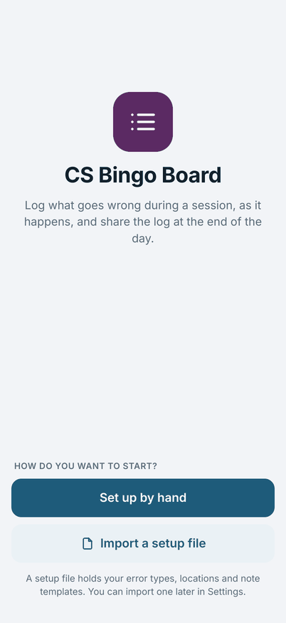
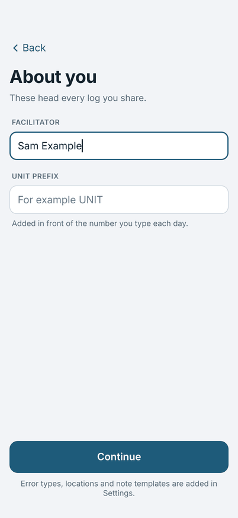
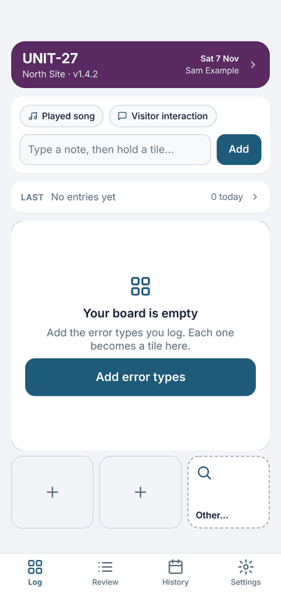
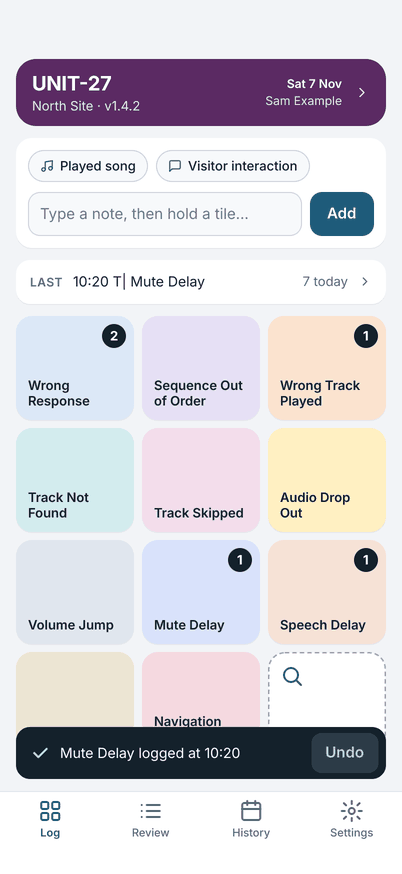

# Getting started

Field Test is for logging what goes wrong during a robot session, as it happens, and sharing the log at the end of the
day. You tap a tile for each error, add a short note when it helps, and share one plain text log.

Everything stays on your device. Nothing is sent anywhere unless you share the log yourself ([Privacy](../privacy.md)).

## Install

Install Field Test from your device's store. It runs on iPhone and iPad, and on Android phones and tablets.

## The first time you open it

The first screen asks how you want to start.

{ width="270" }

**If someone gave you a setup file**, tap **Import a setup file**. A setup file holds the error types, the places and the
note templates your team uses, so your board is ready at once. The app shows what is in the file and asks you to confirm
before it changes anything. See [Importing and exporting](setup.md#importing-and-exporting-a-setup-file).

**If you set up on your own**, tap **Set up by hand**. The app asks two things, which head every log you share:

- **Facilitator**: your name.
- **Unit prefix**: the letters before a unit's number, for example `UNIT`. You type only the number each day.

{ width="270" }

Tap **Continue**. The Log screen opens with an empty board and a button, **Add error types**. Add the types you log. Each
one becomes a tile. [Setting up the board](setup.md) shows how.

{ width="270" }

## Your first entry

1. Fill in **Today's details** (tap the purple card at the top) with the unit number, place and software version. You can
   skip it and log first: the card tells you what is not filled in yet. [Today's details](todays-details.md) explains each field.
2. **Double-tap** a tile. A message says what was logged and when, and the tile's count goes up.
3. If you tapped the wrong tile, tap **Undo** on the message within five seconds.

{ width="270" }

Next: [A day of logging](logging.md).
