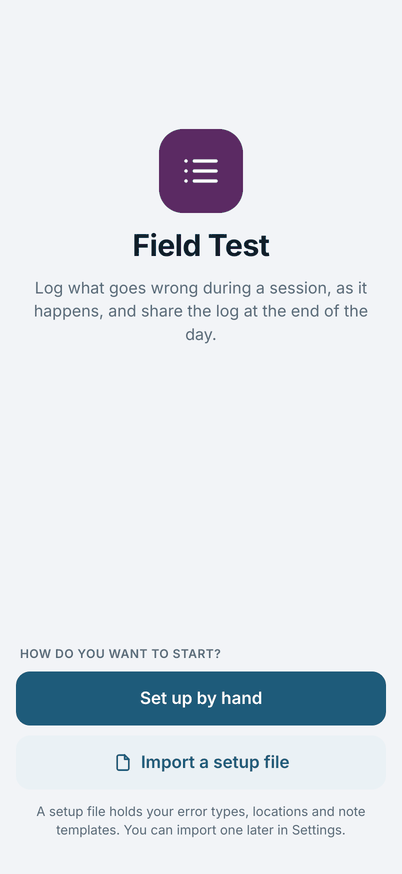
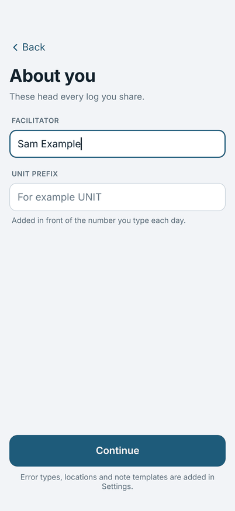
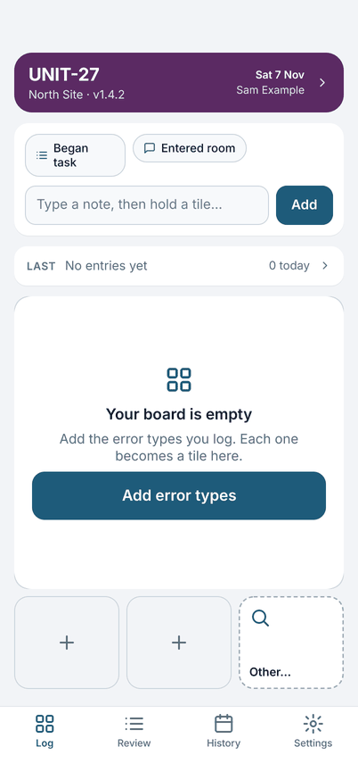
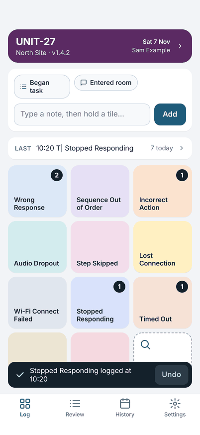

# Getting started

Field Test is an error log for software and hardware testing sessions. You tap a tile for each error as it happens, add a
short note when it helps, and share one plain text log at the end of the day.

!!! note "In short"
    - Runs on iPhone and iPad. Install it from the App Store.
    - **Double-tap** a tile to log an error with the time. A single tap only shows a hint.
    - Everything stays on your device until you share the log yourself ([Privacy](../privacy.md)).
    - You can start logging before the details are filled in.

<!-- When Android ships, say: Install Field Test from your device's store. It runs on iPhone and iPad, and on Android phones and tablets. -->

## The first time you open it

The first screen asks how you want to start.

{ width="270" }

### If someone gave you a setup file

Tap **Import a setup file**. A setup file holds the error types, the places and the note templates your team uses, so
your board is ready at once. The app shows what is in the file and asks you to confirm before it changes anything. See
[Importing and exporting](setup.md#importing-and-exporting-a-setup-file).

### If you set up on your own

Tap **Set up by hand**. The app asks two things, which head every log you share:

| Field | What to enter |
|---|---|
| **Tester** | Your name. |
| **Unit prefix** | The letters before a unit's number, for example `UNIT`. You type only the number each day. |

{ width="270" }

Tap **Continue**. The Log screen opens with an empty board and a button, **Add error types**. Add the types you log. Each
one becomes a tile. [Setting up the board](setup.md) shows how.

{ width="270" }

## Your first entry

1. Tap the purple card at the top and fill in **Today's details**: the unit number, the place and the software version.
   You can skip this and log first. The card tells you what is not filled in yet.
   [Today's details](todays-details.md) explains each field.
2. **Double-tap** a tile. A message says what was logged and when, and the tile's count goes up.
3. If you tapped the wrong tile, tap **Undo** on the message within five seconds.

{ width="270" }

At the end of the day, open **Review** and tap **Share log**. [Sharing and the next day](sharing.md) covers that step.

## Where to go next

- **Your day:** [A day of logging](logging.md), and the [Quick reference](quick-reference.md) for gestures and timings.
- **Your team's setup:** [Setting up the board](setup.md), and [Rolling out to a team](rolling-out.md) if you prepare it for others.
- **Something is not working:** [Troubleshooting](troubleshooting.md).
