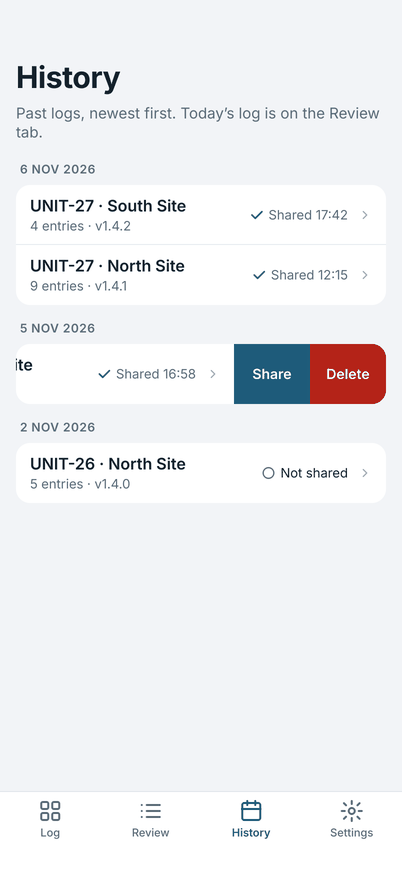
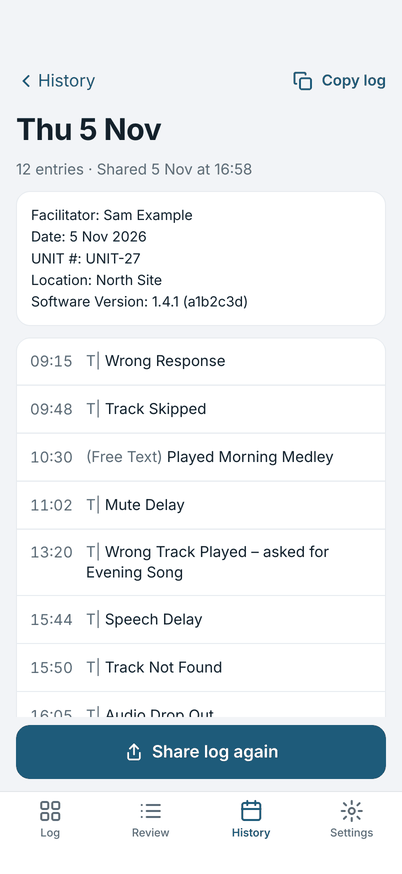
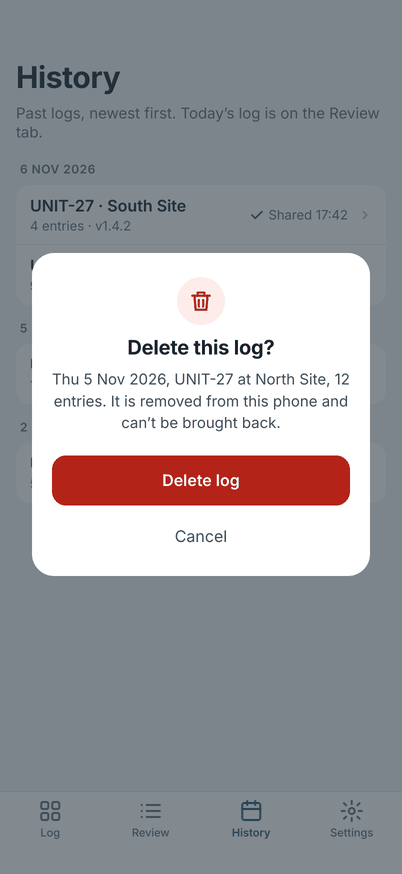

# History

**History** lists past logs, newest first, with the unit, place, number of entries, software version and whether it was
shared. Today's log is on the Review tab.

{ width="270" }

## Open a past log

Tap a log to read it, in the same words as it was shared. You can edit an entry, copy the log, or tap **Share log again**.
A log changed after its last share shows **Changed since sharing** until you share it again.

{ width="270" }

## Share or delete from the list

Swipe a log left in History for **Share** and **Delete**.

**Delete** asks first. A deleted log is removed from this phone and can't be brought back.

{ width="270" }

## What is kept

Past logs stay on the phone until you delete them. They are not sent anywhere ([Privacy](../privacy.md)). Importing a new
setup does not touch them.
