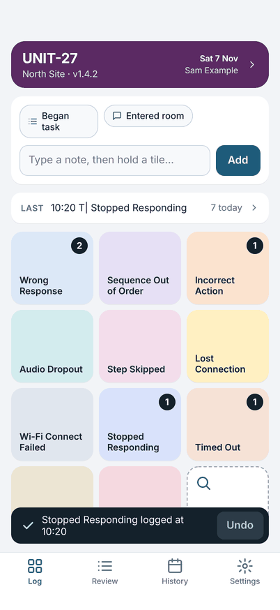
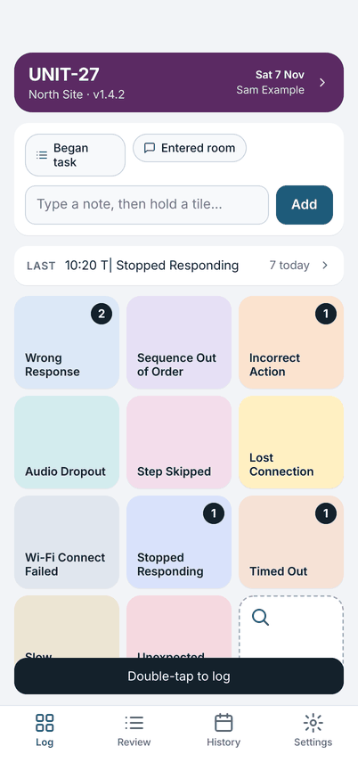
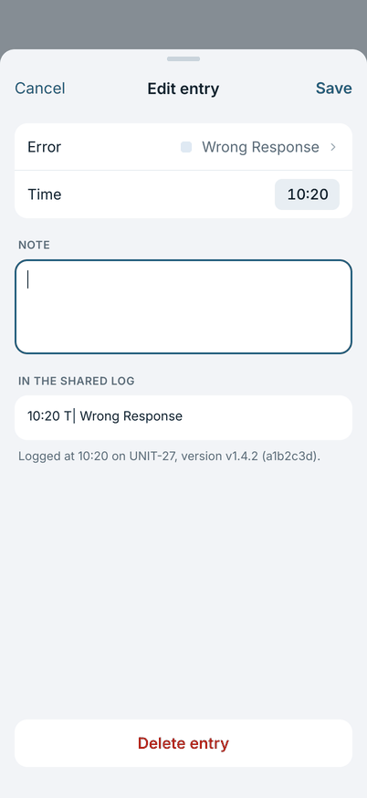
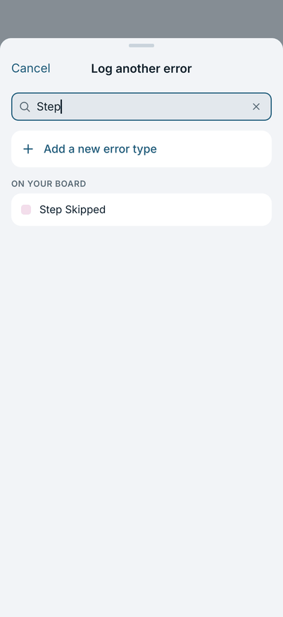
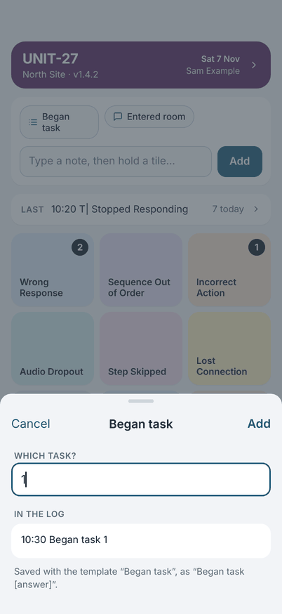

# A day of logging

The Log screen is the one you use all day. From the top: **Today's details**, your note chips and note field, the
**Last** bar, and the board.

{ width="270" }

| To do this | Do this |
|---|---|
| Log an error | **Double-tap** its tile |
| Log an error with a note | **Hold** its tile for half a second |
| Take back the last entry | Tap **Undo** within five seconds |
| Log an error that is not on the board | Tap **Other…** |
| Log a note on its own | Type it and tap **Add** |

The [Quick reference](quick-reference.md) has these with the timings and limits.

## Log an error: double-tap

**Double-tap** a tile to log that error with the time of the tap. The tile shows a count of how many you logged today, and
a message appears at the bottom.

One tap logs nothing. It only shows the hint **Double-tap to log**, so a touch by accident never makes an entry.

{ width="270" }

## Undo and repeats

For five seconds after you log, the message has an **Undo** button. It removes that entry completely.

If the same error happens again while the message is showing, double-tap the tile again. The message changes to **×2**,
**×3** and so on, so a repeat is easy to spot.

After the message has gone, change or delete an entry in [Review](sharing.md#review).

## Log an error with a note: hold

**Hold** a tile for half a second to log the error with a note, as one entry.

- **You typed a note but did not tap Add.** The hold logs the error with that note and clears the field. One **Undo** takes
  the entry back and puts your note back in the field.
- **The note field is empty.** The hold logs the error and opens **Edit entry** with the cursor in the note. **Save** adds
  the note. **Cancel** keeps the entry without a note.

{ width="270" }

## Other: errors that are not on the board

The last tile, **Other…**, opens on one tap. It lists every error type, with a search field, and **Add a new error type** at
the top. Pick one to log it, as if you had double-tapped its tile.

{ width="270" }

## Notes

Type in the note field and tap **Add** to log a note on its own. It is timed when you add it, not when you started typing.

- Return starts a new line, so a note can have several. While you type, the field opens over the board to five lines and
  then scrolls, and it folds back to one line when you leave it. The shared text prints each note on one line.
- A note you started and did not add is kept if you leave the app.

### Dictating a note

On a phone that can recognise speech on the phone itself, the note field has a microphone at its right-hand end (the left
in a right-to-left language). Tap it, speak, and your words appear as you say them. Tap it again to stop.

- It also stops after a minute of silence, when you leave the app, or when you tap **Add**. The note is what the box holds
  at that moment, and the keyboard goes down.
- Nothing listens until you tap it. The first time, the phone asks you to allow the microphone and speech recognition. If
  you refuse, the note says so and typing works as before.
- The words are recognised on the phone: no sound and no text are sent anywhere. You can edit them like any text.
- Where the phone cannot recognise speech on the phone for your language, there is no microphone.

### Note templates

**Note templates** are the chips above the field. Tap one, answer its question and tap **Add**. The line in the log is
written for you, and the sheet shows how it will look.

{ width="270" }

## The Last bar

The **Last** bar shows the latest entry and how many entries you have today. Tap it to open Review.

## The Observations board (optional)

With the second board turned on (see [Setup](setup.md#the-second-board-observations-optional)), the **Observations** tab is a
board like the Errors board, for what you did around the unit. [Observations](observations.md) explains how the two
boards differ. **Double-tap** a tile to log it. A count badge, the undo message and **hold to add the note you typed** work
as they do for errors. The **Other** tile lists the observation types that are not on the board.

The app has no observation types of its own. The board shows only the types you make, in **Settings**, **Observation types**,
or that a setup file brings (see [the setup file](setup-file.md)). Until you make one, the board is empty and its tiles say
**Add observation type**.

### The entry is logged first, and the question comes second

If the type has a line with a person in it (for example “Paired with [person]”), a list of **People** opens at once:

- The people you used last are chips under the heading **Recent**. Tap one to tick it. People saved for the place in force
  today come first in the list.
- Type a name in the search field. If nobody matches, tap **Add "name" as a new person**. You type a name once; next time
  you pick it from the list. A name that differs only by capital letters or spacing is the same person.
- Tap a name to tick it, tap again to untick. You can tick up to 20 people. **Everyone here** ticks the people saved for the
  place that is in force today.
- Tap **Done** to put the ticked people on the entry. **Skip** leaves it as it was logged. It shows as “person not set”.

If the type has an answer in its line (Began task, Assigned), a small sheet asks for it. **Cancel** leaves the entry as logged.

!!! tip "Nothing is lost if you stop halfway"
    The entry is saved before either sheet opens, so closing a sheet or putting the phone away never loses it. **Undo**
    removes the entry and closes the sheet. Names stay on the phone. They are not in the setup file, and the text you share
    shows them as initials by default.

Next: [Today's details](todays-details.md).
