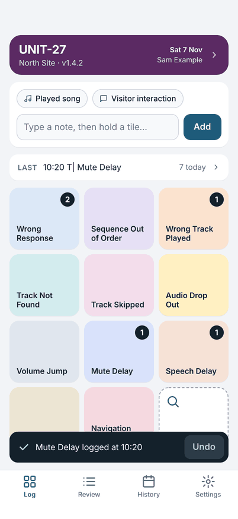
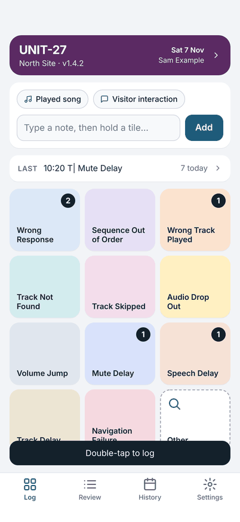
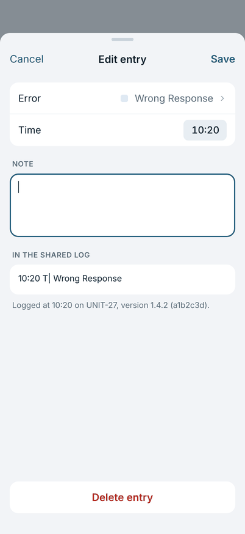
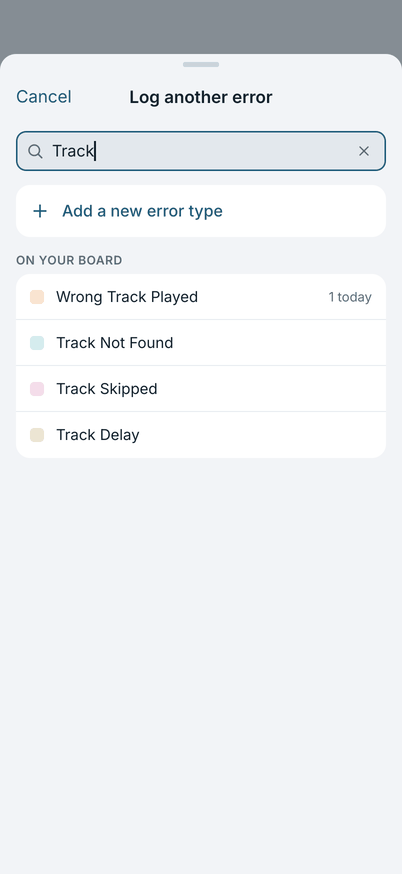
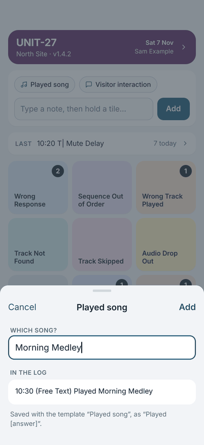

# A day of logging

The Log screen is the one you use all day. At the top is **Today's details**, then your note chips and note field, the
**Last** bar, and the board.

{ width="270" }

## Log an error: double-tap

**Double-tap** a tile to log that error with the time of the tap. The tile shows a count of how many you logged today, and
a message appears at the bottom.

One tap logs nothing. It only shows the hint **Double-tap to log**, so a touch by accident never makes an entry.

{ width="270" }

## Undo and repeats

For five seconds after you log, the message has an **Undo** button. It removes that entry completely. If the same error
happens again while the message is showing, double-tap the tile again: the message changes to **×2**, **×3** and so on, so
a repeat is easy to spot.

After the message has gone, change or delete an entry in [Review](sharing.md#review).

## Log an error with a note: hold

**Hold** a tile for half a second to log the error with a note, as one entry.

- If you typed a note in the note field but did not tap **Add**, the hold logs the error with that note and clears the field.
  One **Undo** takes the entry back and puts your note back in the field.
- If the note field is empty, the hold logs the error and opens **Edit entry** with the cursor in the note. **Save** adds the
  note. **Cancel** keeps the entry without a note.

{ width="270" }

## Other: errors that are not on the board

The last tile, **Other…**, opens on one tap. It lists every error type, with a search field, and **Add a new error type** at
the top. Pick one to log it, as if you had double-tapped its tile.

{ width="270" }

## Notes

Type in the note field and tap **Add** (or Return) to log a note on its own. It is timed when you add it. A note you started
and did not add is kept if you leave the app.

**Note templates** are the chips above the field. Tap one, answer its question and tap **Add**. The line in the log is
written for you, and the sheet shows how it will look.

{ width="270" }

## The Last bar

The **Last** bar shows the latest entry and how many entries you have today. Tap it to open Review.

Next: [Today's details](todays-details.md).
