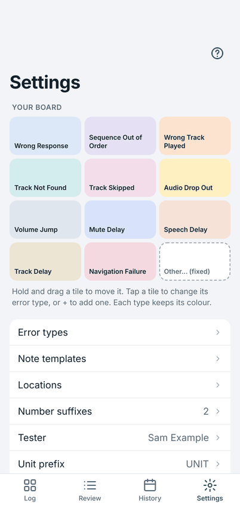
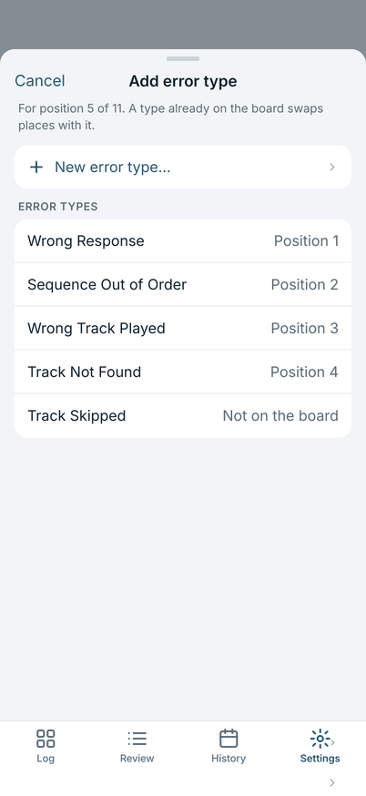
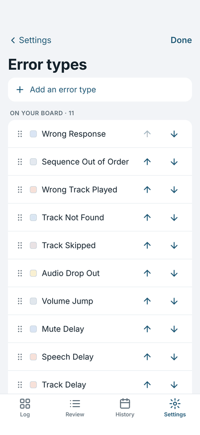
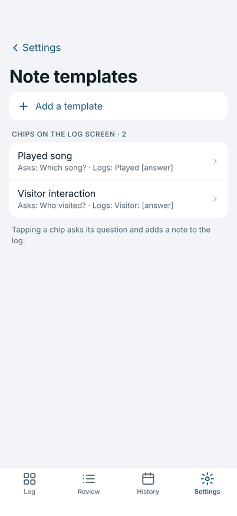
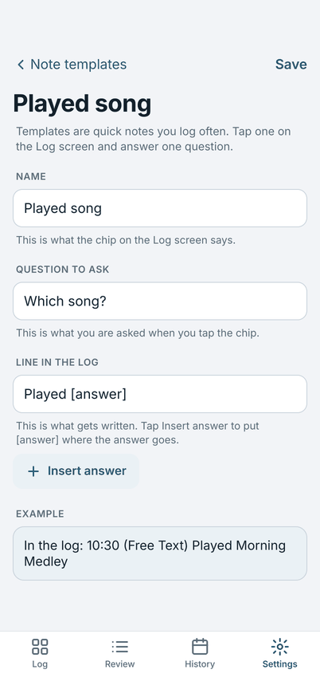
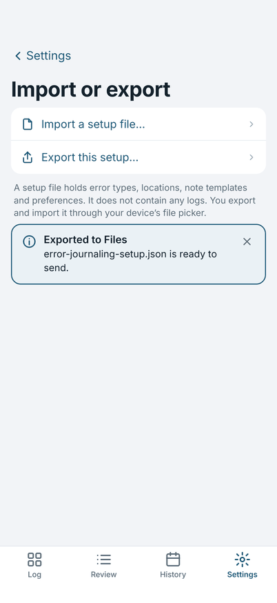
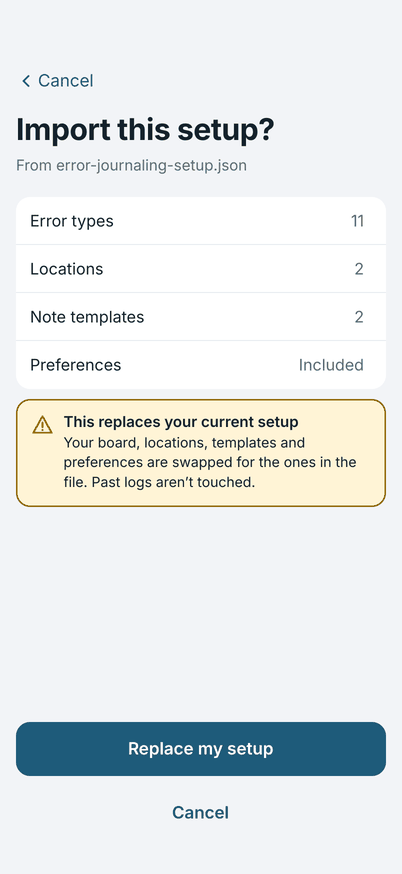
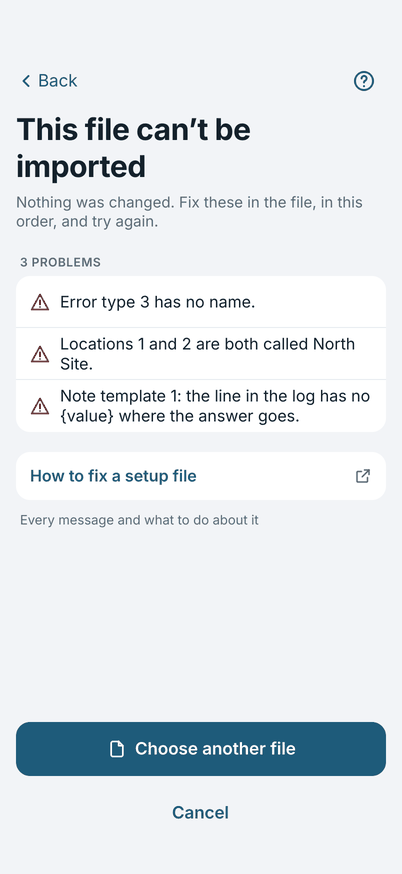

# Setting up the board

Everything that makes the app yours is in **Settings**: the tiles on the board, your error types, places and note
templates, and your name and unit prefix.

{ width="270" }

## Your board

**Your board** at the top of Settings is a small copy of the Log screen's tiles. The board holds 11 error types and the
fixed **Other…** tile.

- **Move a tile:** hold and drag it to another place. The type keeps its colour.
- **Change a tile's type:** tap the tile, then choose a type from the list. If that type is already on the board, the two
  swap places.
- **Fill an empty place:** an empty place shows **+**. Tap it and choose a type, or **New error type…** to make one.

{ width="270" }

## Error types

**Error types** is the whole list of what you can log. Add one with **Add an error type**. The first 11 on the list fill
the board in the order shown. The rest are found under **Other** on the Log screen.

- **Order:** drag the handle, or use the arrows. The top 11 are the board.
- **Rename or recolour:** tap a type.
- **Retire:** a type you no longer use. It leaves the board and Other, and stays on entries already logged.

{ width="270" }

## Locations and number suffixes

**Locations** are the places you work in, for example North Site. They are the choices for Location in Today's details.
**Number suffixes** are the choices for the Number suffix on Today's details, for example `prod` and `dev`; **None** is always the first choice.

## Note templates

A template is a quick note you log often. Tap its chip above the note field on the Log screen, answer its one question,
and the line goes in the log.

{ width="270" }

Each template has three parts:

- **Name:** what the chip on the Log screen says.
- **Question to ask:** what you are asked when you tap the chip, for example "Which song?".
- **Line in the log:** what gets written. Tap **Insert answer** to put `[answer]` where your answer goes, for example
  "Played [answer]". The **Example** at the bottom of the screen shows the line as it will appear.

{ width="270" }

## Your name, prefix and totals

- **Facilitator** and **Unit prefix** are the two things asked on first launch. They head every log.
- **Include a totals line** adds a line at the end of a shared log with the count of each error type.
- **Time format** and **Error prefix** are further down the list. The error prefix is the marker before each error line
  (`T|` unless you change it). Change it only if the tool that reads your log expects something else.

## Importing and exporting a setup file

**Import or export** in Settings moves your setup between devices or people.

{ width="270" }

- **Export this setup…** makes a setup file and offers it to the share sheet or the file picker.
- **Import a setup file…** reads one. The app shows what is in it first.

{ width="270" }

Importing **replaces your setup** (board, locations, templates and preferences). Past logs are not touched, and a setup file
has no logs in it.

If the file has problems, the app lists every one, in the order they appear in the file, and changes nothing.

{ width="270" }

[The setup file](setup-file.md) explains every key and every message, for whoever prepares the file.
