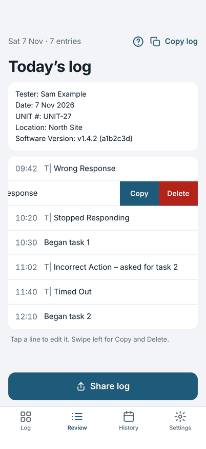
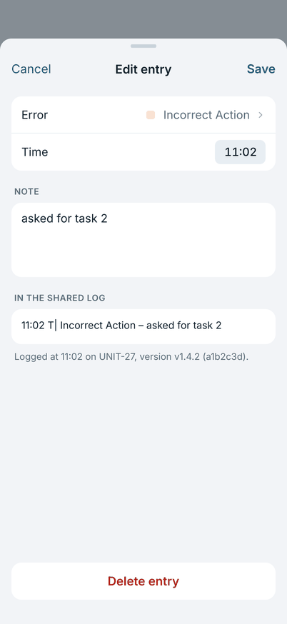
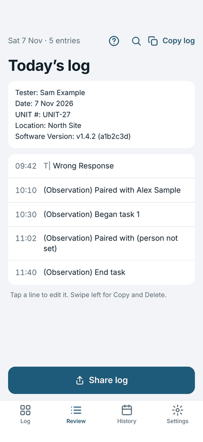
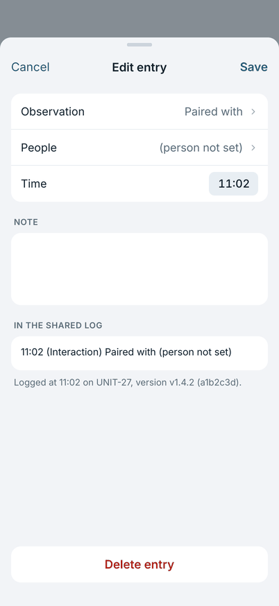
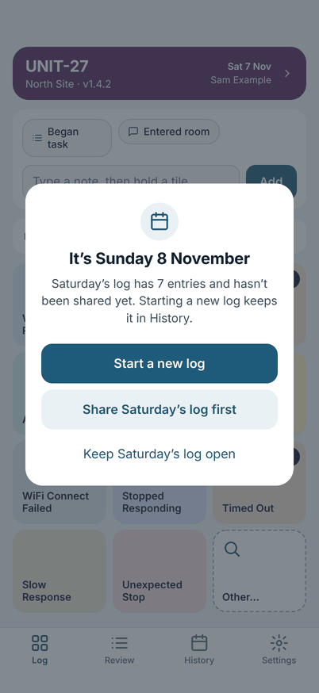

# Sharing and the next day

At the end of the day you read the log in **Review**, share it, and the next morning the app offers a new one.

## Review

The **Review** tab is today's log, in the same words that you share. It shows the header and every entry in time order.
Two things differ from the shared text: an observation shows the person's full name here, and a shared log carries names at
the level you choose in Settings (see below).

{ width="270" }

| To do this | Do this |
|---|---|
| Edit an entry | Tap it. Change the error or note, the time or the attached note, then tap **Save**. **Cancel** keeps it as it was. |
| Copy or delete an entry | Swipe it left for **Copy** and **Delete**. |
| Copy the whole log | Tap **Copy log** at the top. |
| Share the log | Tap **Share log**. |

{ width="270" }

### Filter the entries

Under the header, **Filter** narrows the entries you see. It does not change the log.

- **Kinds:** tap **Errors**, **Notes**, **Observations** or **Changes** to see only those entries. Tap more than one to
  see either. Tap one again to turn it off. **Observations** is there when you use the second board or the log has one.
- **Words:** type in the field. Every word has to be in the entry. It ignores capital letters, accents and extra spaces,
  so `cafe` finds `Café`. The time of an entry is not searched.
- **Both** together show only the entries that match both. **Clear** shows every entry again, and the Filter row says how
  many are shown, for example `Filter · 4 of 27`.

Filtering only changes what Review shows. **Copy log**, **Share log** and **Share log again** always use the whole log,
and the entry count at the top is the whole log's. Tap, swipe, **Copy** and **Delete** work on the entries you see. The
filter is not saved: it clears when you leave the log, start a new one or close the app. A past log in
[History](history.md) has the same filter.

### Observations in Review

If you use the second board, an observation shows on its own line in the same words as the export, for example
`Paired with Alex Sample`, with the full name.

{ width="270" }

On the screen the name is always in full. What **Copy log** and **Share log** carry follows the name setting in Settings
(initials by default). A person you have forgotten reads as **someone**. An observation that asks for a person but has none
shows **(person not set)**.

Tap an observation to open **Edit entry**. You can change the observation, the people, the answer, the time and the note.

- **People** opens the same picker as the board: tick or untick people, search, add a new person, or tick **Everyone here**.
  People who are retired or forgotten stay on the entry until you untick them.
- **Save** keeps the change and **Cancel** leaves the entry as it was. Nothing is saved until you tap **Save**.
- This is also how you add the people to an entry you logged with **Skip** and left without a person.
- Swipe, Copy, Delete and Undo work as for an error.

{ width="270" }

## Share the log

Tap **Share log** at the end of the day. The share sheet opens with the log as plain text, ready to post or send.

The log has a header (tester, date, unit, location, software version) and one line for each entry:

```
10:20 T| Stopped Responding
11:02 T| Incorrect Action – asked for task 2
```

An error line is the time, the error prefix `T|`, the error type, and then the note after a dash. A note on its own, with no
error, is the time and the words, with no prefix.

!!! warning "Do not edit the lines after you share"
    The downstream ticket indexer reads the `T|` marker. The prefix can be changed in Settings if your tool reads a
    different one. [The shared log format](shared-log-format.md) describes every line.

If you use the second board, an observation is a line of its own with no `T|`, so the ticket indexer does not read
it:

```
10:12 Paired with A.S.
10:31 Began task 1
```

### Names in a shared log

A person's name is written in a shared or copied log at the level you choose in Settings:

| Setting | Written as |
|---|---|
| **Initials** (the default) | `A.S.` |
| **Full name** | `Alex Sample` |
| **Someone** | `someone` |

Share, **Copy** and **Copy log** all use that choice, also for a log from an earlier day that you share again. Review and
the board always show the full name, because they never leave your phone. The list of people itself is never exported, and
the totals line counts errors only.

### Share and copy

Only **Share log** marks a log as shared. Copying does not.

## The next day

The first time you open the app on a later date, it offers to start a new log.

{ width="270" }

- **Start a new log.** Today's log starts empty, and yesterday's stays in History.
- **Share Saturday's log first.** Shown when the old log has not been shared, or has changed since it was.
- **Keep Saturday's log open.** Carry on in the same log. This is for a session that runs past midnight.

Starting a new log never deletes anything. A log you did not share stays in History until you share or delete it.
