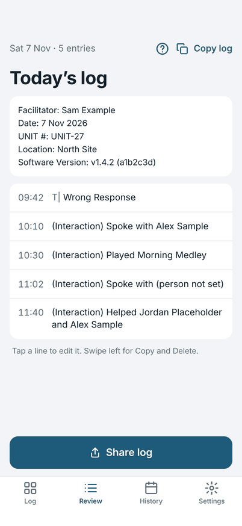
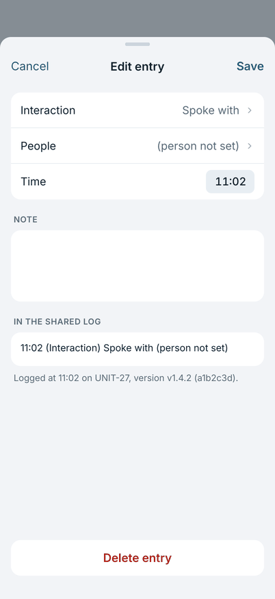

# Sharing and the next day

## Review

The **Review** tab is today's log, in the same words that you share. It shows the header and every entry in time order.

{ width="270" }

- **Edit an entry:** tap it. Change the error or note, the time, or the attached note, then tap **Save**. **Cancel** keeps
  it as it was.
- **Copy or delete an entry:** swipe it left for **Copy** and **Delete**.
- **Copy log** at the top copies the whole log.

### Interactions in Review

If you use the second board, an interaction shows on its own line in the same words as the export, for example
`Spoke with Alex Sample`, with the full name.

{ width="270" }

On the screen the name is always in full; what **Copy log** and **Share log** carry follows the name setting in Settings
(initials by default). A person you have forgotten reads as **someone**. An interaction that asks for a person but has
none shows **(person not set)**.

Tap an interaction to open **Edit entry**. You can change the interaction, the people, the answer, the time and the
note. **People** opens the same picker as the board: tick or untick people, search, add a new person, or tick
**Everyone here**; people who are retired or forgotten stay on the entry until you untick them. **Save** keeps the change
and **Cancel** leaves the entry as it was; nothing is saved until you tap **Save**. This is also how you add the people
to an entry you logged with **Skip** and left without a person. Swipe, Copy, Delete and Undo work as for an error.

{ width="270" }

{ width="270" }

## Share the log

Tap **Share log** at the end of the day. The share sheet opens with the log as plain text, ready to post or send.

The log has a header (facilitator, date, unit, location, software version) and one line for each entry:

```
10:20 T| Mute Delay
11:02 T| Wrong Track Played – asked for Evening Song
```

An error line is the time, the error prefix `T|`, the error type, and then the note after a dash. The downstream ticket
indexer reads the `T|` marker, so do not change the lines after you share. A note on its own, with no error, is marked
`(Free Text)` instead. The prefix can be changed in Settings if your tool reads a different one.

If you use the second board, an interaction is a line of its own, marked `(Interaction)` and with no `T|`, so the ticket
indexer does not read it:

```
10:12 (Interaction) Spoke with A.S.
10:31 (Interaction) Played Morning Medley
```

A person's name is written in a shared or copied log at the level you choose in Settings: initials (the default, `A.S.`),
the full name, or `someone`. Share, **Copy** and **Copy log** all use that choice, also for a log from an earlier day that
you share again. Review and the board always show the full name, because they never leave your phone. The list of people
itself is never exported, and the totals line counts errors only.

Only **Share log** marks a log as shared. Copying does not.

## The next day

The first time you open the app on a later date, it offers to start a new log.

{ width="270" }

- **Start a new log:** today's log starts empty, and yesterday's stays in History.
- **Share Saturday's log first:** shown when the old log has not been shared, or has changed since it was.
- **Keep Saturday's log open:** carry on in the same log. This is for a session that runs past midnight.

Starting a new log never deletes anything. A log you did not share stays in History until you share or delete it.
