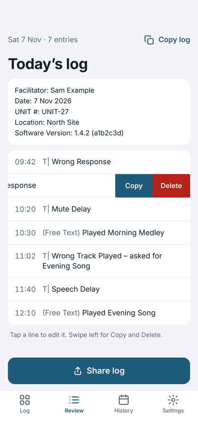
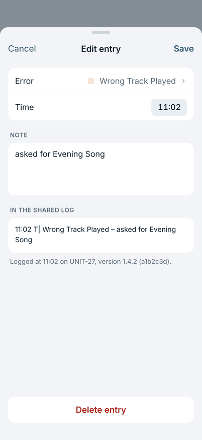
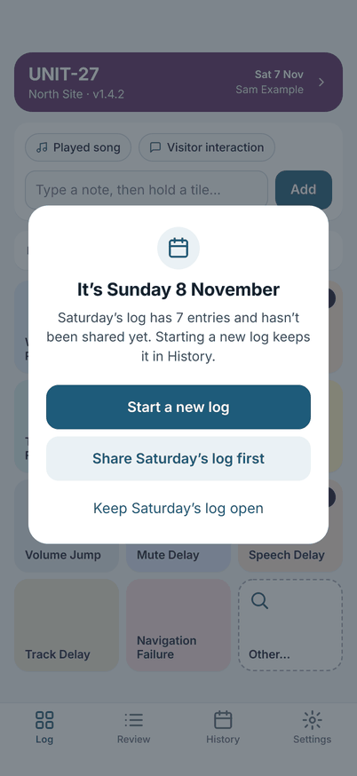

# Sharing and the next day

## Review

The **Review** tab is today's log, in the same words that you share. It shows the header and every entry in time order.

{ width="270" }

- **Edit an entry:** tap it. Change the error or note, the time, or the attached note, then tap **Save**. **Cancel** keeps
  it as it was.
- **Copy or delete an entry:** swipe it left for **Copy** and **Delete**.
- **Copy log** at the top copies the whole log.

{ width="270" }

## Share the log

Tap **Share log** at the end of the day. The share sheet opens with the log as plain text, ready to post or send.

The log has a header (facilitator, date, unit, location, software version) and one line for each entry:

```
10:20 T| Mute Delay
11:02 T| Wrong Track Played – asked for Evening Song
```

An error line is the time, the error prefix `T|`, the error type, and then the note after a dash. The downstream ticket
indexer reads the `T|` marker, so do not change the lines after you share. A note on its own, with no error, is marked
`(Free Text)` instead. The prefix can be changed in Settings if your tool reads a different one.

Only **Share log** marks a log as shared. Copying does not.

## The next day

The first time you open the app on a later date, it offers to start a new log.

{ width="270" }

- **Start a new log:** today's log starts empty, and yesterday's stays in History.
- **Share Saturday's log first:** shown when the old log has not been shared, or has changed since it was.
- **Keep Saturday's log open:** carry on in the same log. This is for a session that runs past midnight.

Starting a new log never deletes anything. A log you did not share stays in History until you share or delete it.
