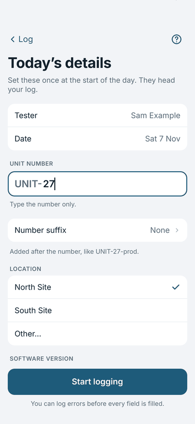
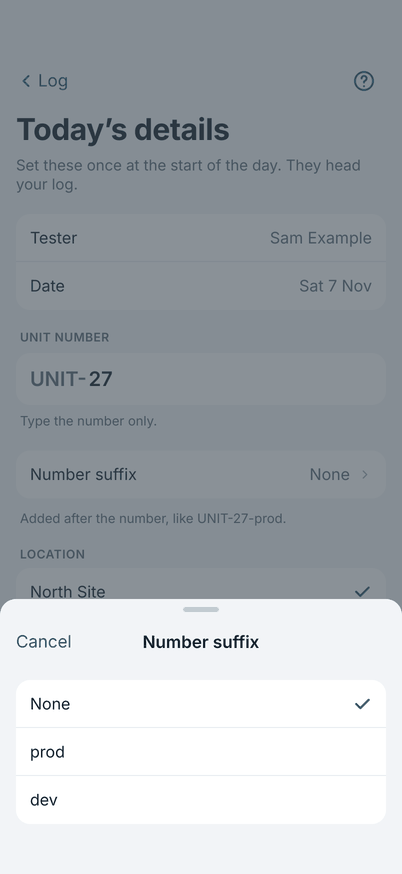
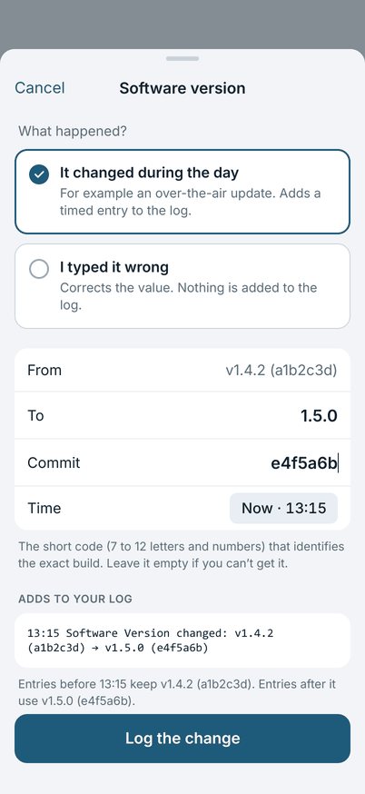

# Today's details

The purple card at the top of the Log screen shows the unit, place, software version, date and your name. Tap it to open
**Today's details**. These fields head the log you share.

{ width="270" }

You can log errors before every field is filled in. While a field is empty the card says **Not filled in yet** and names it.

## The fields

| Field | What to enter |
|---|---|
| **Tester** | Filled in for you. Change the name in Settings. |
| **Date** | Filled in for you. |
| **Unit number** | The number only. The prefix from Settings is added, so `27` shows as `UNIT-27`. |
| **Number suffix** | Tap to choose a word that goes after the number, such as `prod` or `dev`, so `27` shows as `UNIT-27-prod`. You do not type it. **None** is the first choice, and the rest come from **Number suffixes** in Settings. It is saved with the unit number. |
| **Location** | Choose a place from your list, or **Other…** and type where you are. |
| **Software version** | The version of the software under test. Type the numbers only, like `1.4.2`: the field already shows the **v**, and the log prints `v1.4.2`. If you type a v yourself it is not doubled. |
| **Commit** | The short code (7 to 12 letters and numbers) that identifies the exact build. Leave it empty if you can't get it. |
| **Other versions** | Other software that matters to the log. See below. |

{ width="270" }

### Other versions

Use **Other versions** for other software that matters to the log, such as a companion phone app. The row shows them in
short, for example `Influencer v4.5.0`, or **None**.

1. Tap the row to open a sheet, then tap **Add a version**.
2. Give it a name and type its numbers, then tap **Done**.
3. To remove one, tap **Remove this version**.

Every version is printed in the log under the main version, for example `Influencer Version: v4.5.0`.

!!! note "A version stays until you remove it"
    A version you add stays on every new log. The next day you only type its number. Until you do, it shows as `not set`
    in the row, in the log (`Influencer Version: not set`) and in the Not filled in yet strip. Changes made here correct
    the log; they do not add a line to it.

## When the software version changes

If the software version changes during the day, for example an over-the-air update, change it in Today's details. The app
asks **What happened?**

- **It changed during the day.** This adds a timed entry to the log, so the entries before it keep the old version and the
  ones after it use the new one. You can set the time it changed.
- **I typed it wrong.** This corrects the value. Nothing is added to the log.

{ width="270" }

## Starting another log

At the bottom of Today's details, **Start a new log for another unit or site** keeps today's log in History and opens an
empty one. Only the tester carries over. Use it when you move to another unit or site on the same day. A new day
starts its own log (see [Sharing and the next day](sharing.md#the-next-day)).
