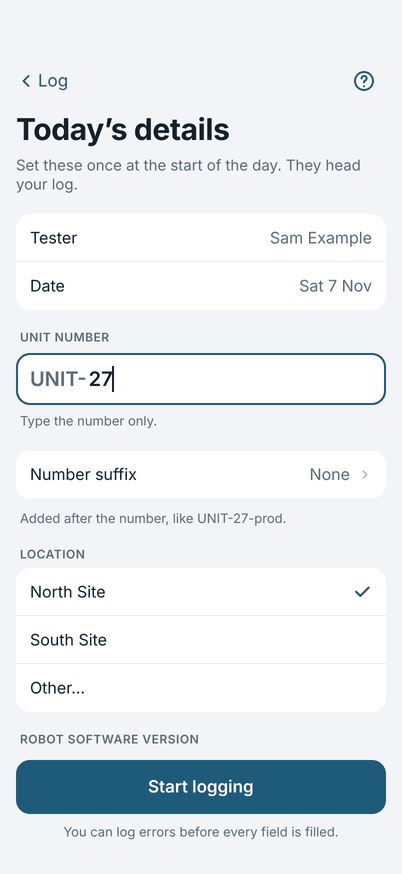
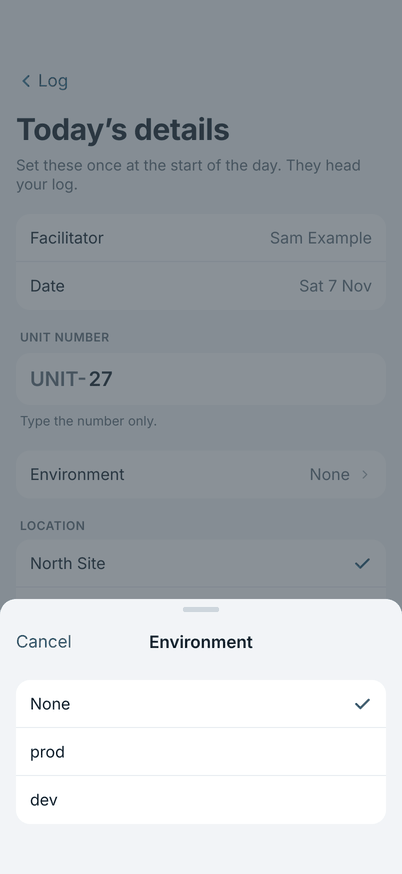
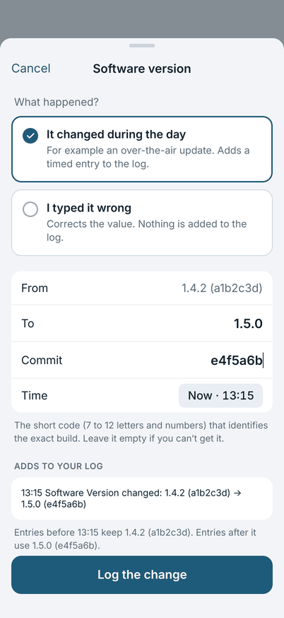

# Today's details

The purple card at the top of the Log screen shows the unit, place, software version, date and your name. Tap it to open
**Today's details**. These fields head the log you share.

{ width="270" }

You can log errors before every field is filled in. While a field is empty the card says **Not filled in yet** and names it.

## The fields

- **Tester** and **Date** are filled in for you. Change the name in Settings.
- **Unit number:** type the number only. The prefix from Settings is added for you, so `27` shows as `UNIT-27`.
- **Number suffix:** tap to choose a word that goes after the number, such as `prod` or `dev`, so `27` shows as `UNIT-27-prod`. You do not type it. **None** is the first choice. The rest come from **Number suffixes** in Settings. It is saved with the unit number.
- **Location:** choose a place from your list, or **Other…** and type where you are.
- **Robot software version:** the version the robot is running. Type the numbers only, like `1.4.2`: the field already shows the **v**, and the log prints `v1.4.2`. If you type a v yourself it is not doubled.
- **Commit:** the short code (7 to 12 letters and numbers) that identifies the exact build. Leave it empty if you can't get it.
- **Other versions:** other software that matters to the log, such as the phone app that controls the robot. The row shows them in short, for example `Influencer v4.5.0`, or **None**. Tap it to open a sheet: **Add a version**, give it a name and type its numbers, then tap **Done**. Remove a version with **Remove this version**. Every version is printed in the log under the robot's, for example `Influencer Version: v4.5.0`. Changes made here correct the log; they do not add a line to it.

{ width="270" }

## When the software version changes

If the robot's version changes during the day, for example an over-the-air update, change it in Today's details. The app asks
**What happened?**

- **It changed during the day:** adds a timed entry to the log, so the entries before it keep the old version and the ones
  after it use the new one. You can set the time it changed.
- **I typed it wrong:** corrects the value. Nothing is added to the log.

{ width="270" }

## Starting another log

At the bottom of Today's details, **Start a new log for another unit or site** keeps today's log in History and opens an
empty one. Only the tester carries over. Use it when you move to another unit or site on the same day. A new day
starts its own log (see [Sharing and the next day](sharing.md#the-next-day)).
