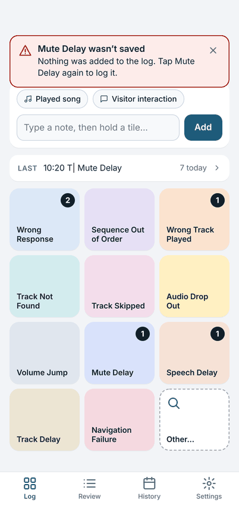
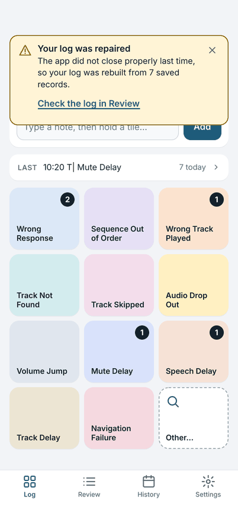
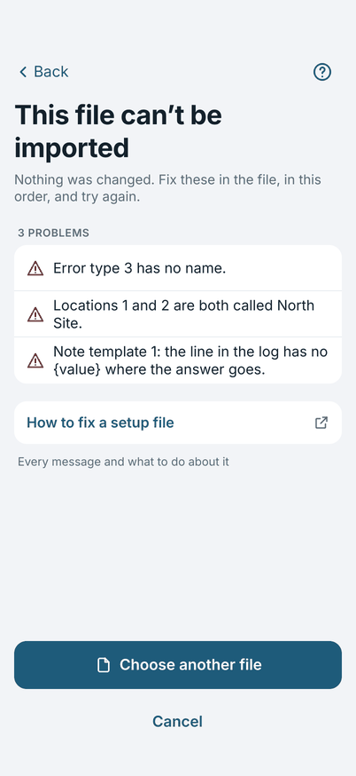

# Troubleshooting

Each problem below says what you see, what it means, and what to do. If yours is not here, see [Support](../support.md) and
say what the app said, word for word.

## "… wasn't saved"

{ width="270" }

**What it means:** the app could not write that entry, so it did not add it. The app never shows an entry as logged before
it is saved.

**What to do:** tap the same tile again (double-tap). One possible cause is a phone that is out of free storage: make room, then
log it again. If it keeps happening, restart the app and tell Support what the message said. Entries logged before the
message are safe.

## "Your log was repaired"

{ width="270" }

**What it means:** the app was closed in the middle of something, for example the phone ran out of battery. When it opened
again it checked today's log and rebuilt it from the entries it had saved.

**What to do:** tap **Check the log in Review** and read the last few entries against what you remember. Add or correct any
that are missing or wrong. Then close the message.

## "This file can't be imported"

{ width="270" }

**What it means:** the setup file has problems. The app changed nothing: your own setup is as it was.

**What to do:** the messages are in the order they appear in the file, and each says where the problem is. Fix them in the
file, then tap **Choose another file**. [The setup file](setup-file.md#when-the-app-refuses-a-file) explains every message.
If someone else made the file, send them the list.

## "The log was not shared"

**What it means:** the share did not go through. Nothing was changed, and the log is still **Not shared**.

**What to do:** try again. Or tap **Copy log** at the top of Review and paste the log into a message yourself. Copying does
not mark the log as shared.

## The board is empty

You have no error types, or you just started. Tap **Add error types**, or import a setup file. See
[Setting up the board](setup.md).

## A tile is missing from the board

The board holds 11 error types. A type that was retired, or that is lower than 11th in the **Error types** list, is not on
the board: it is under **Other…**. To put a type on the board, open **Settings**, tap the tile you want to replace and choose
the type. See [Setting up the board](setup.md#your-board).

## An entry has the wrong time

Open **Review**, tap the entry and change **Time**, then tap **Save**.

## The new day prompt did not appear, or came back

The prompt appears the first time you open the app on a later date than the open log. If you chose **Keep … log open**, the
log stays open and you carry on in it. To start a new log at any time, open Today's details and tap
**Start a new log for another unit or site**.

## I replaced my setup by mistake

Importing replaces the board, locations, templates and preferences, and there is no undo. Your logs are not touched. Import
the earlier setup file again if you have one. This is a reason to export your setup, from **Settings**, **Import or export**,
before you try a new file.
