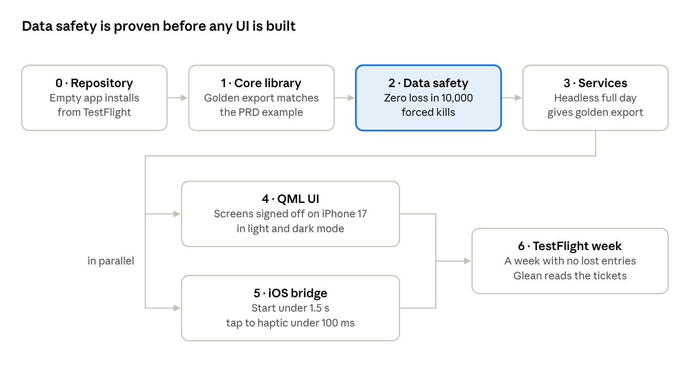

# Field Test – Implementation plan v1

7 Nov 2026 · Iain Chesworth

v1 is built in seven stages, core library and its tests first, so the export format and data safety are proven before any UI exists. Requirement IDs refer to the PRD.

## Stages at a glance

v1 stages · each box shows its exit gate

Stages 0 to 3 run in sequence. The UI and the iOS bridge run in parallel once the services exist, and both must pass before the TestFlight week.

## Stage 0 – Repository and pipeline

The repository iainchesworthlabs/icl-error-journaling, created from the organisation template, builds an empty Qt Quick app for macOS and iOS in CI.

- Create icl-error-journaling from the template, GPL-3.0-or-later. App name Field Test (iOS display name and App Store name; renamed from CS Bingo Board on 12 Nov 2026, and before that from ICL Error Journaling on 8 Nov 2026), develop as trunk and main for releases.

- CMake presets for macOS desktop and iOS device and simulator. Dependencies through the organisation vcpkg fork; Qt from the shared common folder locally and aqtinstall in CI.

- Targets: ej_core (C++23 library, QtCore only), ej_storage, ej_app (QML), ej_ios_bridge (Objective-C++), plus test targets.

- Staged CI per the standard: static checks on draft PRs, then desktop build and tests with TSan, then the iOS build.

- App Store provisioning for the repository; TestFlight upload from the organisation keys.

- A sample configuration file with fictional values (config/sample-config.json). The real configuration never enters the repository; a .gitignore rule and a CI check reject any other \*-config.json.

**Exit gate:** a signed empty app installs from TestFlight on an iPhone 17, and CI is green on all tiers.

## Stage 1 – Core library

The domain model and the export renderer are built and tested on the desktop with no UI and no database. The export is the contract the downstream ticket indexer depends on, so it is fixed by golden tests first.

| Component                      | Responsibility                                                                                                                                    | PRD           |
|--------------------------------|---------------------------------------------------------------------------------------------------------------------------------------------------|---------------|
| UnitNumber                     | Parse digits only, no leading zeros; format as \<prefix\>-\<n\>.                                                                                  | HDR-02        |
| SoftwareVersion                | Strict major.minor.patch parse and compare.                                                                                                       | HDR-04        |
| Timestamp and TimeZoneProvider | UTC milliseconds plus IANA zone; conversion behind an interface, implemented with QTimeZone so the core does not depend on platform tzdb support. | Data model    |
| TimeFormatter                  | 24-hour HH:mm default; 12-hour and seconds options.                                                                                               | PRF-07        |
| Log, Entry and entry kinds     | Log aggregate holding error, note and header-change entries in time order, with soft delete.                                                      | Data model    |
| HeaderHistory                  | Works out the header in force at any time from the initial values and change entries. Correct and Change behave differently.                      | HDR-07        |
| NoteTemplate                   | Output pattern with {value}.                                                                                                                      | NOTE-04       |
| ExportRenderer                 | Header block, ticket-marked error lines, (Free Text) notes, header-change lines, optional totals.                                                 | Export format |
| Configuration                  | Versioned JSON schema for preferences, error types, locations and templates; import validation with clear errors.                                 | PRF-08        |
| DayBoundary                    | Decides when a log belongs to an earlier calendar day.                                                                                            | DAY-01        |

**Tests**

- Golden export files that reproduce the PRD example byte for byte, plus cases for empty header fields, attached notes, templated notes, mid-day version change, totals on and off, and deleted entries.

- Unit number and version parsing, including rejects (027, 1.4, 1.4.2-beta).

- Header history: entries before and after a change, a corrected change, a change then a correction.

- Time zones: the Melbourne daylight-saving changes, and a log that runs past midnight.

- Configuration round-trip, and rejection of malformed or future-version files.

**Exit gate:** all core tests pass with TSan and sanitisers on, and the golden export matches the PRD example.

## Stage 2 – Storage and data safety

Persistence is proven against forced kills before the UI depends on it, because losing the open log is a P1 defect.

- SQLite schema version 1 through Qt SQL, behind a LogRepository interface so the core is also testable against an in-memory database.

- WAL mode with synchronous FULL. A write returns only after commit; the caller shows feedback after that (DS-01).

- Append-only journal file for the open log: one JSON line per change, flushed and fsynced before the database commit, with the write acknowledged only after both (DS-02). Finished logs keep their journals.

- Recovery on launch: quick integrity check, replay the journal over the database for any change missing from it, and rebuild from the journal alone if the database fails the check (DS-03, DS-04). Recovery returns a summary for the UI message.

- Archive, never delete, when a new log starts. Hard delete only from History, with confirmation (DS-05).

- Migration framework: copy the database file, migrate in a transaction, restore the copy on failure (DS-06).

- Note draft stored on every change, debounced to 300 ms (NOTE-03).

**Tests**

- Kill harness on the desktop: a child process writes entries at a steady rate and is killed with SIGKILL at random points; the parent reopens and checks that every acknowledged entry is present. 1,000 iterations per CI run on the nightly tier.

- Corrupt-database cases: truncated file, damaged page, missing file. Each must recover the open log from the journal.

- Journal replay is idempotent: replaying twice gives the same log.

- Migration failure restores the previous database untouched.

**Exit gate:** zero lost acknowledged entries across 10,000 kill iterations, and all corruption cases recover.

## Stage 3 – Application services and models

A thin QObject layer connects the core and storage to QML. QML holds no logic beyond presentation; every rule is testable in C++.

| Service or model | Responsibility                                                                                                             | PRD                             |
|------------------|----------------------------------------------------------------------------------------------------------------------------|---------------------------------|
| LogSession       | Owns the open log: record error, add note, change or correct header, start new log.                                        | BRD-02, NOTE-01, HDR-07, DAY-02 |
| UndoController   | 5-second undo window, repeat count for the same tile, undo of the most recent tap only.                                    | BRD-04, REV-03                  |
| BoardModel       | 11 tiles with type, colour, label and today's count, plus the Other tile.                                                  | BRD-01, BRD-05, BRD-08          |
| TimelineModel    | Entries in time order for the Last line and the review screen, rendered through the export renderer.                       | REV-01                          |
| HistoryModel     | Past logs grouped by date, with shared state.                                                                              | DAY-04                          |
| DayWatcher       | Checks for a new calendar day on launch and on return to the foreground; raises the new-day prompt with the unshared flag. | DAY-01                          |
| SettingsModel    | Tester, prefix, locations, error types, board layout, templates, time format; configuration import and export.        | PRF-01 to PRF-10                |
| ShareService     | Builds the export text and hands it to the platform share interface; records the share time.                               | REV-05                          |

QML-facing names are camelCase; everything else follows the labs C++ casing standard.

**Tests:** Qt Test cases for every service, including undo timing with a fake clock, the double-tap repeat count, day rollover across midnight, and the unshared flag.

**Exit gate:** a headless test drives a full day (header, taps, notes, a version change, review edits, share, new day) through the services and produces the golden export.

## Stage 4 – QML UI

The eight approved screens (https://claude.ai/artifact/ULU3voVz6TiuaLMfQHn1ob) are built as custom Qt Quick components, iterated on the macOS desktop build and checked on device each week.

1.  **Design tokens** as a QML singleton: colours for light and dark mode, the 11 tile colours plus Other, type scale, spacing, radii and motion curves. Dark mode values are designed at this step.

2.  **Components:** Tile with count badge and press animation, UndoToast, HeaderCard, NoteComposer with template chips, LastEntryBar, TabBar, Sheet with grabber, ListRow, SwipeRow, ChoiceCard, MiniBoard for settings.

3.  **Screens:** Log, Other picker, Today’s details, Software version change, Review, Edit entry, New day prompt, Settings with board layout.

4.  **Motion:** spring presses on tiles, sheet presentation and dismissal, toast in and out, and row swipe. Targets the display’s full refresh rate.

5.  **Accessibility:** Accessible names and roles on every control, label sizes that respond to the system text size where the layout allows, and contrast checked in both modes.

No Qt Quick Controls default styling is used anywhere visible (NFR-05).

**Exit gate:** side-by-side review of each screen against the design on an iPhone 17, in light and dark mode, signed off by the tester.

## Stage 5 – iOS bridge and lifecycle

A small Objective-C++ layer covers what Qt does not, behind interfaces with desktop stubs. It can start alongside Stage 4 once Stage 3 is done.

| Item                 | Approach                                                                                                                                      | PRD             |
|----------------------|-----------------------------------------------------------------------------------------------------------------------------------------------|-----------------|
| Share sheet          | UIActivityViewController with the export text, presented from the Qt window’s root view controller; completion reports whether it was shared. | REV-05, DAY-01  |
| Haptics              | UIImpactFeedbackGenerator prepared on touch-down so the tap fires within the latency budget; a success haptic for notes.                      | BRD-03, NFR-03  |
| Configuration import | Exported document type for the configuration file so it opens from AirDrop and Files, plus a document picker in Settings.                     | PRF-08, PRF-09  |
| Data protection      | Database and journal files set to complete-until-first-unlock protection.                                                                     | NFR-09          |
| Lifecycle            | On going inactive: flush the note draft and journal. On becoming active: run the day check.                                                   | NOTE-03, DAY-01 |
| Launch screen        | Matches the board layout so a cold start feels immediate.                                                                                     | NFR-04          |

**Exit gate:** on an iPhone 17, measured with Instruments: cold start to a usable board under 1.5 s and tap to haptic under 100 ms. The share sheet posts to Slack, and a configuration file AirDropped from a Mac imports cleanly.

## Stage 6 – TestFlight and acceptance

The tester uses a TestFlight build in real sessions for one working week before v1 is called done.

1.  Prepare her configuration file outside the repository: tester, UNIT prefix, locations, the 11 board types, any other error types, and the note templates. AirDrop it to her phone.

2.  Run the acceptance checklist on her phone with her: every Must requirement in the PRD, one line per requirement ID, pass or fail.

3.  Shadow week: she logs as normal and posts to Slack each day. Check each day’s post against what she remembers, and confirm the downstream ticket indexer picks up the T\| lines.

4.  Collect feedback in the PRD’s open items and fix blockers in a 1.0.x build.

**Exit gate:** a full week with no lost entries, every Must requirement passing, and the downstream ticket indexer reading the exported tickets.

## Stages 7 to 14 – v1 scope added from 9 Nov 2026

On 9 Nov 2026 the owner widened v1. It now ships publicly on the App Store and the Google Play Store, runs on an iPad in portrait and landscape, and has documentation online and in the app. Landscape stays off on a phone. A desktop build for Mac and Windows is a nice-to-have. The interactions board ([#105](https://github.com/iainchesworthlabs/icl-error-journaling/issues/105)) stayed in v2 at that point. On 13 Nov 2026 the owner moved it into v1 as an optional second board, off by default, with an optional People list (Stage 14, below).

Each stage below gets its own page, `docs/plan/stage-N.md`, which sets out the task breakdown, the test list, the exit gate and the owner's decisions. The owner reviews that page before any code for the stage is written.

| Stage | Scope | Depends on | Exit gate (summary) |
|---|---|---|---|
| 7 – Screen and flow review | Every screen and every flow reviewed end to end on the phone: first launch, setup, a day of logging, sharing, the next day, history, settings and import. Findings are fixed. This includes 4.16's dark-mode and accessibility audit. | Stage 4 and 5 merged | Every flow walked on an iPhone 17 in light, dark and large text; every finding fixed or deferred by the owner |
| 8 – iPad, portrait and landscape | Designs first. In portrait the phone layout is scaled up. In landscape the board and the log sit side by side. The app keeps phone portrait only. | Stage 7 for the screens it changes | Approved iPad mock-ups, built and checked on an iPad, in both orientations, light and dark |
| 9 – Android and Google Play | An Android build of the same app: the platform layer (share, haptics, file picker and open-with, file protection, lifecycle, launch screen), CI, signing and a Play internal-testing track. | Stage 5 interfaces | Installs from Play internal testing on a real Android phone; acceptance checklist passes there |
| 10 – Documentation | A user guide online (with the setup file format, a getting-started guide and an FAQ) and short in-app help where people get stuck. | Stage 7 (final flows) | Guide published; in-app help reachable from every screen that needs it |
| 11 – Store release | App Store and Google Play listings, screenshots for every device size, the privacy policy and support URL, App Review notes, age rating, export compliance, data-safety form, release workflow and versioning. | Stages 7 to 10 | Approved by App Review and Play review; released |
| 12 – Desktop (nice-to-have) | Mac and Windows builds as products: window sizing, keyboard and mouse use, packaging and signing. | Stage 8 (wide layout) | Owner decides whether it ships in v1 |
| 13 – Foldable phones (added 10 Nov 2026) | Book-style foldables (iPhone Duo, Galaxy Z Fold, Pixel Fold, OnePlus Open) and flip phones: one set of size rules for phone, foldable and tablet, a tab rail for short windows, book and tabletop layouts that keep controls off the fold, and no state lost when the device folds. Plan: [stage-13.md](plan/stage-13.md). | Stage 8 (adaptive layout), Stage 9 (Android build) | Approved foldable mock-ups built; Android Studio foldable emulators and Xcode Device Hub checklists pass; nothing lost across a fold; phone and iPad layouts unchanged |
| 14 – Interactions board and people (added 13 Nov 2026) | An optional second board for interactions (what the tester did with or around the thing under test), off by default, with a fifth tab, its own types and lines, and an optional People list that is typed once and picked later. Names live in their own store, never in a log journal or the setup file, and show in shared logs as initials unless the owner changes it. A new entry kind, one schema step, interaction lines in the export (no `T|`, not in totals). Ten packages, I-0 to I-9. Plan: [stage-14.md](plan/stage-14.md). | Stage 2 (storage), Stage 4 (UI), Stages 8 and 13 (layouts for the wide and fold packages) | No acknowledged entry lost with interactions in the kill workload; privacy page and store answers updated; the owner has tried the board on a phone, an iPad and a foldable |

**Decisions the owner must make before Stage 11:**
- **Licence.** The app is GPL-3.0-or-later. App Store distribution terms are widely seen as conflicting with the GPL, and statically linking Qt on iOS and Android brings LGPL obligations. The owner will take advice.
- **Accounts.** A Google Play developer account is needed. Apple's App Store Connect listing for public release is also needed.
- **Hosting.** Where the privacy policy, the support page and the documentation are hosted.
- **Price and reach.** Free or paid, and which countries.

## Testing, risks and blocking decisions

**Test layers**

| Layer                      | What it covers                                                    | Where it runs                                    |
|----------------------------|-------------------------------------------------------------------|--------------------------------------------------|
| Core unit and golden tests | Parsing, header history, time zones, export format, configuration | Every PR, desktop, with TSan and sanitisers      |
| Storage and kill tests     | Durability, recovery, migrations                                  | Every PR (short run), nightly (1,000 iterations) |
| Service tests              | Session flows, undo, day rollover, sharing state                  | Every PR, desktop                                |
| QML tests                  | Component behaviour and screen navigation                         | Every PR, desktop                                |
| Device checks              | Latency, start-up, haptics, share sheet, appearance               | Each TestFlight build, iPhone 17                 |
| Acceptance                 | Every Must requirement, with the tester                                | Stage 6                                          |

**Risks**

| Risk                                                       | Effect                 | Mitigation                                                                                |
|------------------------------------------------------------|------------------------|-------------------------------------------------------------------------------------------|
| Qt Quick looks or feels less native than a Swift app       | Misses the polish goal | Custom components from tokens, motion tuned on device weekly, the tester signs off each screen |
| Share sheet or haptics integration from Qt is awkward      | Delays Stage 5         | Spike both in Stage 0 on the empty app                                                    |
| Platform time zone support differs between desktop and iOS | Wrong times in the log | All conversion goes through QTimeZone; daylight-saving tests in Stage 1                   |
| Data loss from a crash or corruption                       | P1 defect, lost trust  | Stage 2 kill and corruption tests gate all later stages                                   |
| Work data leaks into the public repository                 | Confidentiality breach | Configuration only by file import; CI rejects non-sample config files                     |

**Decisions that block a stage**

- [x] App and repository name – decided: repository icl-error-journaling; public name Field Test everywhere a user sees it (owner, 8 Nov 2026, replacing ICL Error Journaling).

- [ ] Exact spacing of the T\| marker, checked against a line the downstream ticket indexer already reads – blocks the Stage 1 golden tests.

- [ ] Header date format – blocks the Stage 1 golden tests.

- [ ] Dark mode palette – blocks the Stage 4 exit gate.

- [ ] The full list of note templates and other error types – blocks Stage 6 only (it lives in the configuration file).
