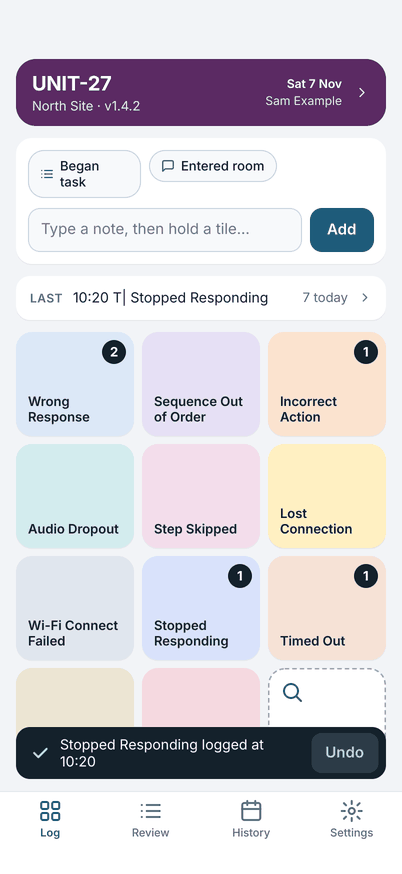
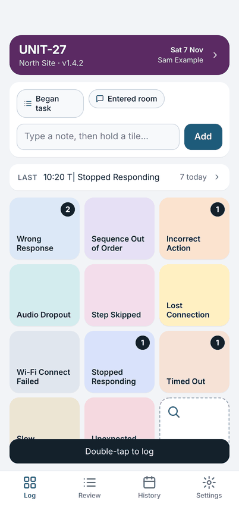
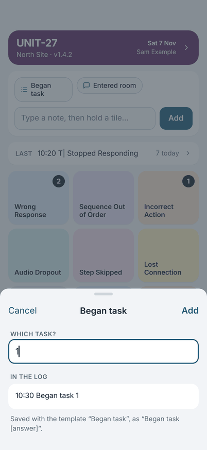
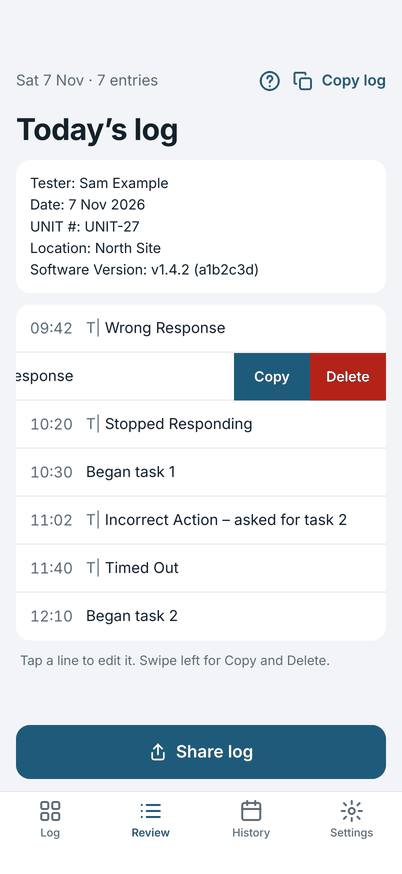
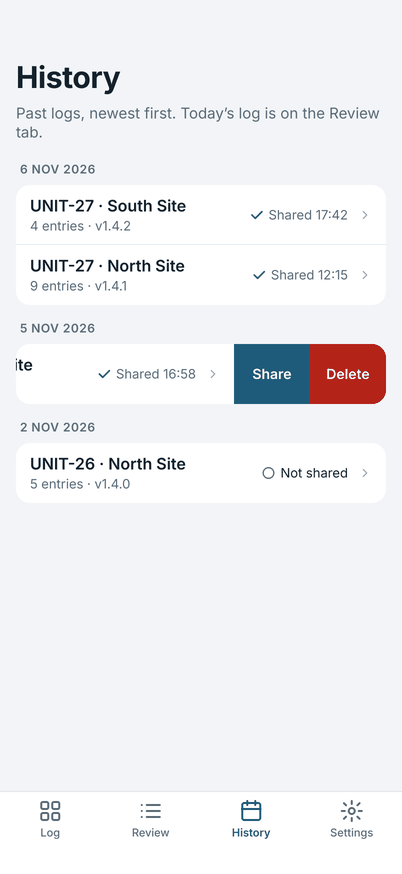

<section class="icl-hero icl-hero--app">

<h1>Log errors during a test session</h1>

Field Test is an error log for people who run software or hardware test sessions. Each common error has its own tile. Double-tap a tile to log the error with the time. At the end of the day, share the log as plain text.

<!-- OWNER DECISION: the App Store badge and link go here when the app is live (Apple's artwork, unmodified, and the App Store ID). Until then this is plain text. -->
Coming to the App Store
<a class="icl-button" href="how-to-use/">How to use it</a>

iPhone and iPad &middot; 6.99 USD, once &middot; No account &middot; Works offline &middot; Data Not Collected

<figure class="icl-device"></figure>

</section>

<section class="icl-section icl-section--tint" id="how">

<h2>How it works</h2>
<ol class="ft-steps">
<li><h3>Set up your board</h3>
Make a tile for each error you log, or import a setup file someone has prepared.
</li>
<li><h3>Double-tap as it happens</h3>
The error is logged with the time. Hold a tile to add a note. Undo is there for five seconds.
</li>
<li><h3>Share the log</h3>
Review the day, then send it as plain text to a chat app, Mail, Files or the clipboard.
</li>
</ol>

<a href="how-to-use/">See how to use it</a>

</section>

<section class="icl-section" id="features">

<h2>What it does</h2>

<h3>Log with a double-tap</h3>

Up to 11 error tiles and an Other tile, each with its own colour and a running count. A tap by accident logs nothing: one tap only shows a hint. Made a mistake? Undo takes it back.

<figure class="icl-device"></figure>

<h3>Notes</h3>

Type a note, or hold a tile to log the error with one. Note templates cover what you write every day, such as which task you began. Where your phone can recognise speech on the phone, you can dictate a note.

<figure class="icl-device"></figure>

<h3>The day's log</h3>

The log has a header with the tester, date, unit, location and software version. If the software changes during the day, that change is logged with its time, so the entries before it keep the old version.

<h3>Share as plain text</h3>

Each entry is one line: the time, a marker, the error and your note. The downstream ticket indexer reads the marker. You can change the marker in Settings if your tool expects something else.

<figure class="icl-device"></figure>

<h3>History</h3>

Every earlier day stays on your device until you delete it. A log you changed after sharing says "Changed since sharing", so you know to send it again.

<h3>Set up your way</h3>

Set up by hand, or import a file from a Mac or another device. Light and dark appearance, larger text, and on iPad the board and the log side by side in landscape.

<figure class="icl-device"></figure>

<a href="features/">All features</a>

</section>

<section class="icl-section icl-section--tint">

<h2>Observations (optional)</h2>

Turn on Observations in Settings to get a second board for what you did as well as what went wrong. It is off until you turn it on, and the app looks the same as before.

A type can ask who was involved: pick Alex Sample from your own list of people, typed once. Turn it off again and nothing is deleted.

<h2>Who it is for</h2>

Testers who run software or hardware test sessions and need a list of what went wrong, and when.

Field Test does not do project tracking, team dashboards or cloud sync. It keeps one person's log on one device and shares it as text.

</section>

<section class="icl-section">

<h2>Privacy</h2>

Field Test has no account, no analytics, no advertising and no crash reporting, and the app does not use the network. Your logs stay on your device, protected by the device's data protection. They leave only when you share them. The App Store lists the app as Data Not Collected.

<a href="privacy/">Read the privacy page</a>. The source code is public, under the GNU General Public License, version 3 or later.

<h2>One price, no subscription</h2>

6.99 USD, once. No in-app purchases. iPhone and iPad, iOS 18.0 or later. The price in your country is shown in the App Store.

</section>

<section class="icl-section icl-section--tint" id="try">

<h2>Try the sample setup</h2>

Download a sample setup file. It has made-up names: Sam Example as the tester, UNIT and North Site, and a board of sample error types such as Wrong Response. Open it on your phone and Field Test offers to import it, after you confirm. It holds no logs.

<a class="icl-button" href="demo/demo-setup.ejconfig">Download the sample setup</a>

</section>

<section class="icl-section" id="faq">

<h2>Questions</h2>

Why does one tap do nothing?

A tile logs on a double-tap, so a touch by accident never makes an entry. One tap shows the hint "Double-tap to log".

Can I log without a connection?

Yes. The app does not use the network.

Can I take back a wrong entry?

Tap Undo within five seconds. After that, open Review: tap the entry to change it, or swipe it left and tap Delete.

All the questions are on the <a href="faq/">FAQ</a> page. Need help? Start with the <a href="guide/">Guide</a>, then <a href="support/">Support</a>.

</section>
