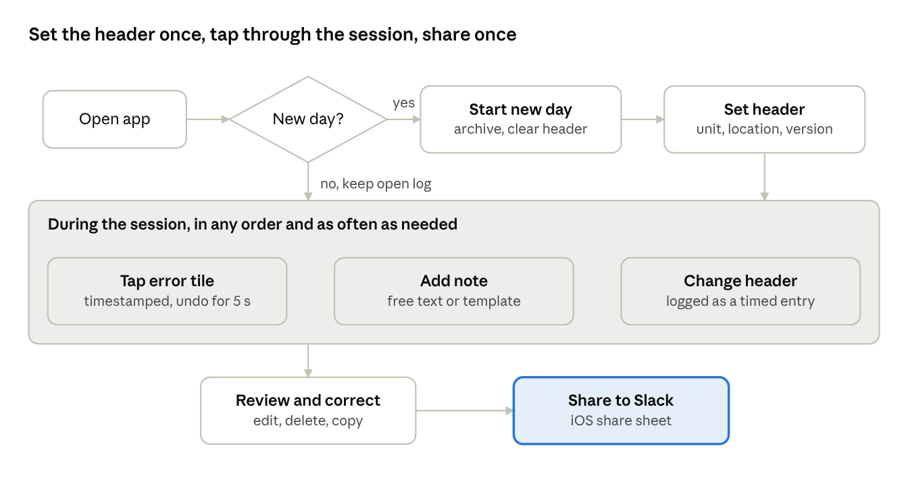

# CS Bingo Board – PRD v1

7 Nov 2026 · Iain Chesworth

## Overview

CS Bingo Board is an iPhone app that lets a facilitator log a timestamped robot error in one tap, keep a running journal of the session, and post the day's log to Slack at the end of the day. It replaces ad-hoc notes typed during sessions, where timings are lost and errors go uncounted.

The app is an Iain Chesworth Labs product built in C++23 with Qt/QML. v1 targets the iPhone 17 and is distributed through TestFlight. An iPad layout is a planned growth path and is out of scope for v1.

**Goals**

1.  Log a common error in under two seconds from opening the app, with an accurate local timestamp.

2.  Keep a complete, time-ordered journal of the day (errors, notes, header changes) that cannot be lost by a mis-tap.

3.  Produce a Slack-ready daily log in the facilitator's existing format with one share action.

4.  Hold no employer data in the codebase; every work-specific value is set in the app's preferences.

5.  Feel like a polished, native-quality iPhone app: fast, fluid, and pleasant to use many times a day.

## Scope

v1 is a single-user, offline iPhone app whose only way off the device is the iOS share sheet.

**In scope for v1**

- Daily log with a header: facilitator, date, UNIT number, location, software version.

- Bingo board of 11 quick-select error tiles plus an Other tile, with per-type tile colours, count badges and an undo toast.

- Free-text journal notes, including pre-templated note types such as "Played song".

- Timestamped header-change entries (for example a software version deployed mid-day).

- Review screen: view, edit, delete and copy any entry.

- Export of the day's log as plain text through the iOS share sheet (Slack, Mail, Files, Copy).

- Day rollover, extra logs on the same day for a move to another unit or site, and archived past logs that can be browsed and re-shared.

- Preferences: facilitator name, locations, error type list, board layout, note templates, time format.

**Out of scope for v1**

- iPad and landscape layouts (planned growth path).

- Android, desktop or any other platform.

- Cloud sync, accounts, backend services or direct Slack integration.

- Photo, video or audio attachments.

- Hardware fault logging (already covered by an existing process).

- Biometric or passcode lock.

- Per-location board layouts.

- Analytics, reporting or charts across days.

## User and context of use

The user is one facilitator running sessions with a robot at a deployed site. She logs from her own iPhone 17, usually one-handed, while her attention is on the session.

The errors are frequent and small: a wrong response, a wrong song, speech latency. The same error can recur five or more times in a session. Hardware faults are rare and logged elsewhere. The app must therefore favour speed of capture over richness of detail; detail can be added or corrected later on the review screen.

She also keeps a loose diary of what she did and roughly when, such as songs played. That diary sits in the same timeline as the errors.

At the end of the day she posts the log to her own Slack channel. The downstream ticket indexer picks up the error lines from that log and reads the T\| marker as a ticket, so the export format is a contract other processes depend on. Work content is confidential, so nothing leaves the phone except through an action she takes.

## Core daily workflow

The header is set once at the start of the day. During the session, each error is a single tap and everything else is optional. The day ends with one share.



daily workflow · one decision, three repeated actions

If the app opens on a later calendar day, it offers to start a new day. Declining keeps the open log, so a session that runs past midnight stays in one log. A new log can also be started at any time from the menu, for the rare move to another unit or site on the same day. A software update during the day, including an over-the-air release, is recorded with the Change action and stays in the same log.

## Functional requirements

Requirements are grouped by feature. Priority is Must (v1 blocker) or Should (v1 target, can slip to 1.1).

### Day header

| ID     | Requirement                                                                                                                                                                                                                                             | Priority |
|--------|---------------------------------------------------------------------------------------------------------------------------------------------------------------------------------------------------------------------------------------------------------|----------|
| HDR-01 | A new day's log is created with the facilitator name from preferences and today's local date already filled in.                                                                                                                                         | Must     |
| HDR-02 | The unit number is entered on a numeric keypad as digits only and shown as \<prefix\>-\<n\> (for example UNIT-27). No leading zeros and no fixed length. The prefix is a preference.                                                                    | Must     |
| HDR-03 | Location is picked from the preference list of locations, or Other with free text.                                                                                                                                                                      | Must     |
| HDR-04 | Software version must match major.minor.patch (digits only, no suffix). Invalid input is flagged inline and cannot be saved.                                                                                                                            | Must     |
| HDR-05 | Header values persist for the day across app restarts and are cleared, except the facilitator, when a new log starts.                                                                                                                                   | Must     |
| HDR-06 | Error taps and notes are allowed before the header is complete. A banner shows which header fields are still empty.                                                                                                                                     | Must     |
| HDR-07 | Each header field has two edit actions. **Correct** fixes a typo and rewrites the value with no log entry. **Change** records that the value changed at a point in time and adds a timestamped entry such as "Software Version changed: 1.4.2 → 1.5.0". | Must     |

### Bingo board

| ID     | Requirement                                                                                                                                                                                                                                                    | Priority |
|--------|----------------------------------------------------------------------------------------------------------------------------------------------------------------------------------------------------------------------------------------------------------------|----------|
| BRD-01 | The main screen shows a grid of 3 columns by 4 rows in portrait. Tiles 1 to 11 are error types chosen and ordered in preferences. Tile 12 is always Other.                                                                                                     | Must     |
| BRD-02 | Tapping a tile records an error entry with the current time (UTC plus the device time zone).                                                                                                                                                                   | Must     |
| BRD-03 | Each tap gives immediate feedback: a haptic, a tile press animation and the new entry appearing in the recent-entries strip.                                                                                                                                   | Must     |
| BRD-04 | An undo toast appears for 5 seconds after each tap, naming the error and time. Undo removes the most recent tap completely. Tapping the same tile again while the toast shows updates it to “×2”, “×3” and so on, so an accidental double tap is easy to spot. | Must     |
| BRD-05 | Each tile shows a count badge for the current log. The Other tile's badge counts all error types not on the board.                                                                                                                                             | Must     |
| BRD-06 | Other opens a searchable sheet of every error type in the master list. Picking one records it like a tile tap. A new type can be added from this sheet and is saved to the master list.                                                                        | Must     |
| BRD-07 | Long-pressing a tile records the error and opens the note field attached to that entry.                                                                                                                                                                        | Should   |
| BRD-08 | Each error type has its own tile colour from a palette of 12 slightly different hues defined in the design package. The colour follows the type when the board is reordered. Other uses a neutral colour.                                                      | Must     |

### Journal notes

| ID      | Requirement                                                                                                                                                                                                                                      | Priority |
|---------|--------------------------------------------------------------------------------------------------------------------------------------------------------------------------------------------------------------------------------------------------|----------|
| NOTE-01 | A note field sits at the top of the main screen. Pressing Add (or Return) commits the text as a journal entry timestamped at commit, then clears the field.                                                                                      | Must     |
| NOTE-02 | Committed entries cannot be changed or deleted from the main screen. Changes happen only on the review screen.                                                                                                                                   | Must     |
| NOTE-03 | Uncommitted text in the note field survives the app being backgrounded or closed.                                                                                                                                                                | Must     |
| NOTE-04 | Note templates appear as chips above the field. Tapping one (for example Played song) asks its question (for example "Which song?"), and the entry is stored with the template and the answer and rendered from the template's line in the log (for example "Played Morning Medley"). | Must     |
| NOTE-05 | Dictation uses the standard iOS keyboard microphone. The app adds no speech recognition of its own.                                                                                                                                              | Must     |
| NOTE-06 | A note can be attached to an error entry, from BRD-07 or from the review screen. It is exported on the same line as the error.                                                                                                                   | Should   |

### Review screen

| ID     | Requirement                                                                                                                                                                   | Priority |
|--------|-------------------------------------------------------------------------------------------------------------------------------------------------------------------------------|----------|
| REV-01 | The review screen shows the day's header and all entries in time order, in the same wording as the export, as plain black-and-white text with no colour coding by entry type. | Must     |
| REV-02 | Tapping an entry opens an edit sheet: error type or note text, time, and attached note. Save and Cancel are explicit.                                                         | Must     |
| REV-03 | Entries can be deleted by swipe. Deletion shows an undo toast and is a soft delete until the toast expires.                                                                   | Must     |
| REV-04 | A single entry line, or the whole log, can be copied to the clipboard.                                                                                                        | Must     |
| REV-05 | A Share button sends the export text (section Export format) to the iOS share sheet.                                                                                          | Must     |

### Day lifecycle and history

| ID     | Requirement                                                                                                                                                                                                                                                                                                                                                            | Priority |
|--------|------------------------------------------------------------------------------------------------------------------------------------------------------------------------------------------------------------------------------------------------------------------------------------------------------------------------------------------------------------------------|----------|
| DAY-01 | When the app opens or returns to the foreground on a later calendar day than the open log, it offers to start a new log, naming the new date. If the open log has not been shared, the prompt says so and offers to share it first. Starting a new log archives the open one. Keeping it open continues logging into it, which covers sessions that run past midnight. | Must     |
| DAY-02 | A new log can be started at any time from the menu, including on the same date. This covers the rare move to another unit or site mid-day. The new log starts with an empty header except the facilitator.                                                                                                                                                             | Must     |
| DAY-03 | A software version change during a log, such as an over-the-air update, uses the Change action (HDR-07) and stays in the same log.                                                                                                                                                                                                                                     | Must     |
| DAY-04 | Past logs are listed newest first, grouped by date. Each can be opened, edited, copied and re-shared.                                                                                                                                                                                                                                                                  | Must     |
| DAY-05 | Past logs are kept until the user deletes them, with a confirmation step.                                                                                                                                                                                                                                                                                              | Must     |

### Preferences and setup

| ID     | Requirement                                                                                                                                                                          | Priority |
|--------|--------------------------------------------------------------------------------------------------------------------------------------------------------------------------------------|----------|
| PRF-01 | Facilitator name.                                                                                                                                                                    | Must     |
| PRF-02 | Unit number prefix (for example UNIT).                                                                                                                                               | Must     |
| PRF-03 | Locations: add, rename, reorder, remove.                                                                                                                                             | Must     |
| PRF-04 | Error types master list: add, rename, retire. A retired type disappears from pickers but stays on past entries.                                                                      | Must     |
| PRF-05 | Board layout, edited on a miniature copy of the board: hold and drag to move a tile, tap a tile to swap in another type.                                                             | Must     |
| PRF-06 | Note templates: name, question to ask and line in the log. The editor says what a template is in one sentence, has an Insert answer button instead of typing {value}, and shows an example line.                                                                                                                             | Must     |
| PRF-07 | Time format, defaulting to 24-hour HH:mm. A 12-hour or with-seconds display is optional. Changing it re-renders all logs, including past days.                                       | Must     |
| PRF-08 | The whole configuration can be exported to and imported from a JSON file through Files or AirDrop. This lets the work-specific setup be prepared and delivered outside the codebase. | Must     |
| PRF-09 | On first launch the app offers to import a configuration file or set up manually.                                                                                                    | Must     |
| PRF-10 | Optional totals line in the export, per error type, default off.                                                                                                                     | Should   |

## Data model

All data lives in a local SQLite database in the app sandbox. Times are stored as UTC milliseconds together with the IANA time zone in effect when the entry was captured, so logs render correctly after travel or a daylight-saving change.

Header values are held as an initial value plus timestamped change entries. The header in force for any entry is worked out from that history, so correcting a value or a change entry flows through to every later entry without rewriting them.

| Entity            | Key fields                                                                                                                       | Notes                                                                                                                                                         |
|-------------------|----------------------------------------------------------------------------------------------------------------------------------|---------------------------------------------------------------------------------------------------------------------------------------------------------------|
| DayLog            | id, local_date, facilitator, unit_number, location_id or location_text, software_version, created_utc, last_shared_utc, archived | One per log. Usually one per day; a second log on the same date covers a move to another unit or site. Header fields hold the values at the start of the log. |
| Entry             | id, day_log_id, kind (error, note, header_change), captured_utc, captured_tz, edited_utc, deleted                                | Common to all entries. Time is editable on the review screen.                                                                                                 |
| ErrorEntry        | entry_id, error_type_id, attached_note                                                                                           | kind = error.                                                                                                                                                 |
| NoteEntry         | entry_id, template_id (nullable), value_text                                                                                     | kind = note. Free text has no template.                                                                                                                       |
| HeaderChangeEntry | entry_id, field (unit_number, location, software_version), old_value, new_value                                                  | kind = header_change. Created by the Change action (HDR-07).                                                                                                  |
| ErrorType         | id, name, retired, board_position (1–11 or null)                                                                                 | Master list. Retired types keep their history.                                                                                                                |
| Location          | id, name, sort_order, retired                                                                                                    |                                                                                                                                                               |
| NoteTemplate      | id, name, value_prompt, output_pattern, sort_order                                                                               | The output pattern uses {value} for the answer; the editor shows it as [answer].                                                                                                                                  |
| Preferences       | facilitator, unit_prefix, time_format, include_totals                                                                            | Single row.                                                                                                                                                   |

IDs are UUIDs. The schema carries a version number with forward migrations from the first TestFlight build. The configuration export (PRF-08) covers Preferences, ErrorType, Location and NoteTemplate. Day logs are not included.

## Export format

The export is plain text in the format of the facilitator's original concept, extended with facilitator, date, header changes and attached notes. It pastes cleanly into Slack and Mail with no markup.

```
Facilitator: Sam Example
Date: 7 Nov 2026
UNIT #: UNIT-27
Location: North Site
Software Version: 1.4.2

10:05 T| Wrong Response
10:20 T| Mute Delay
10:30 (Free Text) Played Morning Medley
11:02 T| Wrong Track Played – asked for Evening Song
13:15 Software Version changed: 1.4.2 → 1.5.0
13:40 T| Speech Delay
```

Rendering rules:

1.  The header block shows the values at the start of the log. Mid-day changes appear only as timeline lines.

2.  An empty header field is rendered with its label and no value.

3.  Error lines are \<time\> T\| \<error type name\>, with an attached note after an en dash. The T\| ticket marker is fixed and not configurable, because the downstream ticket indexer reads it.

4.  Note lines are \<time\> (Free Text) \<text\>, where templated notes render through their template's line in the log. Notes carry no ticket marker.

5.  Header change lines are \<time\> \<field label\> changed: \<old\> → \<new\>, with no ticket marker.

6.  Times are 24-hour HH:mm by default (PRF-07), in the time zone each entry was captured in.

7.  Deleted entries are excluded. If PRF-10 is on, a blank line and a totals line follow the timeline.

8.  The label UNIT \# comes from the unit prefix preference (\<prefix\> \#).

9.  Output is plain text with no colour or formatting.

## Non-functional requirements

The app must feel native, fast and polished on an iPhone 17, used one-handed in portrait, many times a day.

| ID     | Area             | Requirement                                                                                                                                                                                                                                                                                             |
|--------|------------------|---------------------------------------------------------------------------------------------------------------------------------------------------------------------------------------------------------------------------------------------------------------------------------------------------------|
| NFR-01 | Device           | Primary target is iPhone 17 in portrait. Layout respects safe areas and the Dynamic Island, and is laid out so it adapts to other current iPhone sizes and later to iPad.                                                                                                                               |
| NFR-02 | Ergonomics       | The board sits in the lower part of the screen within thumb reach. Tiles are at least 88 pt square with labels of up to three lines that never truncate.                                                                                                                                                |
| NFR-03 | Responsiveness   | Tap-to-feedback under 100 ms. Animations run at the display's full ProMotion refresh rate with no dropped frames during normal use.                                                                                                                                                                     |
| NFR-04 | Start-up         | Cold start to a usable board in under 1.5 s. Returning from background shows the board immediately.                                                                                                                                                                                                     |
| NFR-05 | Visual polish    | A dedicated design pass produces a design package (tokens, screens, motion) before implementation. The UI uses consistent spacing, type and colour tokens, smooth spring-based transitions, and considered empty, error and confirmation states. It must not look like a default Qt Quick Controls app. |
| NFR-06 | Appearance       | Light and dark mode, following the system setting.                                                                                                                                                                                                                                                      |
| NFR-07 | Accessibility    | VoiceOver labels on all controls and Dynamic Type for list and note text. Tile colours avoid red–green pairs and keep label text clearly readable. The label always carries the meaning; colour is a visual aid only. Full colour-blind modes are not required.                                         |
| NFR-08 | Durability       | No loss of committed entries or the note draft if the app crashes, is killed or the phone restarts. Loss of open-log data is a P1 defect; see Data safety.                                                                                                                                              |
| NFR-09 | Privacy          | No network access, analytics, crash reporting SDKs or third-party services. Data stays in the app sandbox under iOS Data Protection and leaves only through the share sheet, copy, or the user's own device backup.                                                                                                                    |
| NFR-10 | Codebase hygiene | The repository contains no employer, site, robot or person names. All such values come from preferences or an imported configuration file.                                                                                                                                                              |
| NFR-11 | Localisation     | English (Australia) only in v1. All user-facing strings are translatable.                                                                                                                                                                                                                               |

### Data safety

Losing entries from the open log is a P1 defect, because the log feeds a critical end-of-day process. Past logs matter less once they have been posted to Slack, but no normal app action may lose them.

| ID    | Requirement                                                                                                                                                                                              |
|-------|----------------------------------------------------------------------------------------------------------------------------------------------------------------------------------------------------------|
| DS-01 | Every entry, edit and delete in the open log is committed to SQLite (WAL, synchronous FULL) before any feedback is shown.                                                                                |
| DS-02 | Each commit is also recorded in an append-only journal file for the open log, which is flushed to storage before the database commit is made and before the entry is acknowledged. A finished log's journal is kept. If the database is missing or fails its integrity check, the logs are rebuilt from the journals. |
| DS-03 | After a crash or forced quit, the next launch reopens the open log with every committed entry and the note draft, with no prompt or extra step.                                                          |
| DS-04 | A quick integrity check runs on every launch, and a full check runs after a failed quick check and after an upgrade. A failure triggers recovery from the journal and a message stating what was recovered.                                                                          |
| DS-05 | No app action deletes or overwrites the open log without explicit confirmation. Starting a new day or a new log archives the open log; it never deletes it.                                              |
| DS-06 | Schema migrations copy the database first and roll back on failure.                                                                                                                                      |
| DS-07 | Automated tests kill the app process at random points during writes and confirm no committed entry is lost. Core tests cover journal replay and recovery from a corrupt database.                        |

## Technology and delivery

The app follows the Iain Chesworth Labs C++23 project standard as the new repository iainchesworthlabs/icl-error-journaling, licensed GPL-3.0-or-later, and is shipped to the facilitator through TestFlight.

**Architecture**

1.  **Core library (C++23, no Qt Quick dependency):** domain model, day lifecycle, header history, validation (semver, unit number), export rendering and time formatting. Fully unit-tested.

2.  **Storage:** SQLite through Qt SQL, with versioned schema migrations, behind a repository interface so the core can be tested against an in-memory database.

3.  **UI (Qt 6, Qt Quick/QML):** custom components and design tokens from the design package, exposed to C++ models through QML-facing names in camelCase.

4.  **iOS platform bridge (Objective-C++):** the native share sheet (UIActivityViewController), haptics (UIFeedbackGenerator) and any keyboard behaviour Qt does not cover. Kept small and behind an interface, with a stub for desktop builds.

**Build and quality**

- CMake with the organisation's vcpkg fork, Qt from the shared common location in local builds and aqtinstall in CI.

- Staged CI per the standard: static checks on draft PRs, then core tests (including TSan) on desktop, then the iOS build.

- A macOS desktop build of the app is kept for development and UI iteration only. It is not a product.

- iOS signing and TestFlight upload use the organisation keys, with App Store provisioning set up for this repository.

**Delivery sequence**

1.  Design: screens approved by the facilitator on 7 Nov 2026 (https://claude.ai/artifact/ULU3voVz6TiuaLMfQHn1ob). Tokens, dark mode and motion are finalised from them.

2.  Implementation plan, starting with the core library and its tests.

3.  Core library, storage, then UI.

4.  TestFlight build to the facilitator, with a configuration file prepared separately and sent by AirDrop.

## Open items and future versions

**Open items**

- [x] App name and repository name: decided – CS Bingo Board on the home screen, in the App Store and in every user-visible text (owner, 8 Nov 2026, replacing ICL Error Journaling); repository icl-error-journaling and bundle identifier com.iainchesworthlabs.errorjournaling unchanged.

- [ ] Dark mode and motion, finalised from the approved light-mode screens. The facilitator's palette of plum and deep blue, and the 11 tile colours, are approved.

- [ ] Note templates: enumerate the list with the facilitator. Played song and Visitor interaction are confirmed; list any others.

- [ ] Confirm the exact spacing of the ticket marker against a line the downstream ticket indexer already picks up (proposed 10:05 T\| Wrong Response).

- [ ] Header date format (proposed 7 Nov 2026).

- [ ] Confirm the 11 board tiles and their order. The proposed set is the 11 named types from the facilitator's concept: Wrong Response; Sequence Out of Order; Wrong Track Played; Track Not Found; Track Skipped; Audio Drop Out; Volume Jump; Mute Delay; Speech Delay; Track Delay; Navigation Failure. This list lives in the configuration file, not the code.

- [ ] Whether app data should be included in the phone's iCloud backup (proposed yes, as standard device backup only).

- [ ] Possible use by other facilitators on the team. v1 stays single-user, but the facilitator preference and configuration file (PRF-08) already allow a second person to set it up.

**Future versions**

- iPad layout, with board and review side by side as in the original concept.

- Logging a chosen error from the Action Button, a Lock Screen widget or Shortcuts.

- Per-error-type export phrases, such as "UNIT-27 gave a wrong response".

- Structured fields for song errors (requested and actual song).

- CSV export and simple cross-day counts.

- Per-location board layouts, if site-specific errors appear.

- A second board for logging interactions, with its own tab and its own interaction types, set up like the error board ([#105](https://github.com/iainchesworthlabs/icl-error-journaling/issues/105)). Raised by the facilitator; deferred on 9 Nov 2026.

- An Android build, if colleagues on Android would use it ([#106](https://github.com/iainchesworthlabs/icl-error-journaling/issues/106)). Deferred on 9 Nov 2026.
